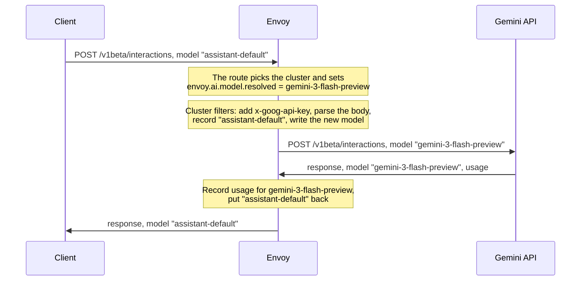

# Gemini Interactions in the AI Protocol Manager

Design only, no code. Base: upstream/main `d7b74bd624` (2026-10-19).

## Summary

The Gemini Interactions API (`POST /v1beta/interactions`) is Google's newer API for Gemini models.
This design teaches Envoy's AI Protocol Manager to recognize it, record its token usage, and
change the model a request asks for, so a gateway can choose which Gemini model serves a client.
Envoy does not convert Interactions requests to or from any other API.

## Background

### The Interactions API

A request names a model and an input. The response lists the steps the model took, the last one
being its answer, and the tokens it used:

```
POST /v1beta/interactions
{"model": "gemini-3-flash-preview", "input": "Explain Envoy overload manager."}
```

```json
{"id": "v1_Chd...", "object": "interaction", "model": "gemini-3-flash-preview", "status": "completed",
 "steps": [{"type": "thought", "signature": "..."},
           {"type": "model_output", "content": [{"type": "text", "text": "The overload manager ..."}]}],
 "usage": {"total_input_tokens": 7, "total_output_tokens": 20, "total_thought_tokens": 22,
           "total_cached_tokens": 0, "total_tool_use_tokens": 0, "total_tokens": 49}}
```

- `"stream": true` in the request body streams the response as server-sent events instead.
- A request names either a `model` or an `agent`, such as Deep Research.
- Stored interactions can be read back with `GET /v1beta/interactions/{id}`, deleted with
  `DELETE`, and cancelled with `POST /v1beta/interactions/{id}/cancel`. The same paths exist under
  `/v1`.

Unlike `generateContent`, the model is in the body rather than the path, and the request and
response bodies have a different shape.

### What Envoy has today

- The **AI Protocol Manager** parses the request body on routes that declare an AI API
  (`AiProtocolManagerPerRoute`). It runs AI filters over the parsed body and records token usage
  from responses as typed metadata (`envoy.ai.token_usage`).
- The **request info** AI filter records the model the client asked for (`envoy.ai.model.request`).
- The **transcoder** AI filter converts a request and its response between two APIs. Before it
  sends a request, it replaces the model with `envoy.ai.model.resolved` when a filter ahead of it
  sets that filter state. The client still sees the model it asked for in the response.
- The APIs known today are OpenAI Chat Completions, OpenAI Responses (usage only), Anthropic
  Messages and Gemini `generateContent`. Interactions is not one of them.

## Goals

1. Recognize Interactions requests and responses, as a new API: `GEMINI_INTERACTIONS`.
2. Record token usage of unary and streamed responses.
3. Let the gateway change the model name, and leave everything else in the request as it is.

Not goals: converting between Interactions and other APIs; agent requests; sending a request to a
backend by its model.

## How it works



Step by step:

1. The router matches the route and picks the Gemini cluster. If the route pins a model,
   `set_filter_state` sets `envoy.ai.model.resolved`.
2. The cluster's upstream filters run:
   - The credential injector sets the gateway's `x-goog-api-key`.
   - The AI Protocol Manager holds the request and parses its JSON body. The route declares
     `GEMINI_INTERACTIONS`, so a body that is not valid JSON is rejected.
   - Request info records the client's model and the other request attributes.
   - The transcoder writes `envoy.ai.model.resolved` into `model` and checks the result against
     the Interactions schema. Nothing else in the body changes, and the path stays as the client
     sent it.
   - The body is written back out, with its Content-Length corrected, and sent to Google.
3. On the way back:
   - The AI Protocol Manager reads usage as the response passes: `usage` in a unary body, or the
     `interaction.completed` event in a stream. It records usage with the model Google reports.
   - The transcoder puts the client's model name back into the response.

### Why the transcoder changes the model

The transcoder is already the filter that applies `envoy.ai.model.resolved`, for every API it
knows. It normally runs as a pair: one instance for the client's side and one for the backend's,
which is the one that writes the model.

Each API is an entry in the transcoder's engine, holding the rules that convert it. The
Interactions entry has no conversion rules, so requests and responses keep their shape. Its only
rules restore the client's model in responses. No filter code changes.

### Where it runs

The AI Protocol Manager runs in the cluster's upstream filter chain, once per attempt, after the
cluster and host are picked. Every attempt reads the same filter state, so the model is set
before the router and does not change between attempts. The same configuration also works in the
downstream chain.

## Examples

### 1. Envoy changes the model

The route pins `gemini-3-flash-preview`. The client asks for `assistant-default`:

```
POST /v1beta/interactions
host: assistant.example.com

{"model": "assistant-default", "input": "Explain Envoy overload manager."}
```

Envoy sends Google:

```
POST /v1beta/interactions
host: generativelanguage.googleapis.com
x-goog-api-key: <gateway key>

{"input": "Explain Envoy overload manager.", "model": "gemini-3-flash-preview"}
```

Google answers with the response shown in [The Interactions API](#the-interactions-api). The
client gets the same response with `"model": "assistant-default"`. The gateway still knows which
model ran:

| Where | Model |
|---|---|
| `envoy.ai.model.request`, request info | `assistant-default` |
| `envoy.ai.model.resolved` | `gemini-3-flash-preview` |
| `envoy.ai.token_usage` | `gemini-3-flash-preview`: input 7, output 42 (20 + 22 thought), total 49 |

### 2. Streaming

With `"stream": true`, the client receives Google's events. Google named `gemini-3-flash-preview`
in the two events that carry a model, and Envoy replaces it:

```
event: interaction.created
data: {"event_type": "interaction.created", "interaction": {"id": "v1_...", "model": "assistant-default", "object": "interaction", "status": "in_progress"}}

event: step.delta
data: {"delta": {"text": "The overload", "type": "text"}, "event_type": "step.delta", "index": 1}

event: interaction.completed
data: {"event_type": "interaction.completed", "interaction": {"id": "v1_...", "model": "assistant-default", "object": "interaction", "status": "completed", "usage": {"total_input_tokens": 11, "total_output_tokens": 90, "total_thought_tokens": 245, "total_tokens": 346}}}

event: done
data: [DONE]
```

Every other event keeps its content. Usage comes from `interaction.completed`.

### 3. The client picks the model

A route that declares only the response API. Envoy does not hold or parse the request, and only
reads the response for usage.

### 4. Get, delete and cancel

These are plain routes with no AI config. A get returns a stored interaction, which can carry the
usage of the request that created it; a configured route would count that usage a second time.

## Configuration

`GEMINI_INTERACTIONS` does not exist yet. With it replaced by `GEMINI_GENERATE_CONTENT` and the CA
path adjusted, this file passes `envoy --mode validate` on a build of `d5eb7030ad`.

```yaml
static_resources:
  secrets:
  - name: gemini-api-key
    generic_secret:
      secret: {environment_variable: GEMINI_API_KEY}

  listeners:
  - name: ai_gateway
    address:
      socket_address: {address: 0.0.0.0, port_value: 10000}
    filter_chains:
    - filters:
      - name: envoy.filters.network.http_connection_manager
        typed_config:
          "@type": type.googleapis.com/envoy.extensions.filters.network.http_connection_manager.v3.HttpConnectionManager
          stat_prefix: ai_gateway
          access_log:
          - name: envoy.access_loggers.stdout
            typed_config:
              "@type": type.googleapis.com/envoy.extensions.access_loggers.stream.v3.StdoutAccessLog
              log_format:
                text_format_source:
                  inline_string: "%REQ(:METHOD)% %REQ(:PATH)% %RESPONSE_CODE% model=%FILTER_STATE(envoy.ai.model.request:PLAIN)% resolved=%FILTER_STATE(envoy.ai.model.resolved:PLAIN)%\n"
          route_config:
            name: ai_routes
            virtual_hosts:
            # Example 1: Envoy changes the model.
            - name: assistant
              domains: [assistant.example.com]
              request_headers_to_remove: [authorization, accept-encoding]
              routes:
              - match:
                  safe_regex: {regex: "/v1(beta)?/interactions"}
                  headers: [{name: ":method", string_match: {exact: POST}}]
                route: {cluster: gemini_api, auto_host_rewrite: true, timeout: 300s}
                typed_per_filter_config:
                  envoy.filters.http.ai_protocol_manager:
                    "@type": type.googleapis.com/envoy.extensions.filters.http.ai_protocol_manager.v3.AiProtocolManagerPerRoute
                    request: {llm_protocol: GEMINI_INTERACTIONS}
                    response: {llm_protocol: GEMINI_INTERACTIONS}
                  envoy.filters.http.set_filter_state:
                    "@type": type.googleapis.com/envoy.extensions.filters.http.set_filter_state.v3.Config
                    on_request_headers:
                    - object_key: envoy.ai.model.resolved
                      format_string:
                        text_format_source: {inline_string: gemini-3-flash-preview}
              - match:
                  safe_regex: {regex: "/v1(beta)?/interactions/[^/]+(/cancel)?"}
                route: {cluster: gemini_api, auto_host_rewrite: true, timeout: 300s}
            # Example 3: the client's model goes through; Envoy only meters usage.
            - name: gemini
              domains: ["*"]
              request_headers_to_remove: [authorization, accept-encoding]
              routes:
              - match:
                  safe_regex: {regex: "/v1(beta)?/interactions"}
                  headers: [{name: ":method", string_match: {exact: POST}}]
                route: {cluster: gemini_api, auto_host_rewrite: true, timeout: 300s}
                typed_per_filter_config:
                  envoy.filters.http.ai_protocol_manager:
                    "@type": type.googleapis.com/envoy.extensions.filters.http.ai_protocol_manager.v3.AiProtocolManagerPerRoute
                    response: {llm_protocol: GEMINI_INTERACTIONS}
              # Example 4: no AI config, so a stored interaction's usage is not metered again.
              - match:
                  safe_regex: {regex: "/v1(beta)?/interactions/[^/]+(/cancel)?"}
                route: {cluster: gemini_api, auto_host_rewrite: true, timeout: 300s}
          http_filters:
          # Sets filter state only where a route configures it.
          - name: envoy.filters.http.set_filter_state
            typed_config:
              "@type": type.googleapis.com/envoy.extensions.filters.http.set_filter_state.v3.Config
          - name: envoy.filters.http.router
            typed_config:
              "@type": type.googleapis.com/envoy.extensions.filters.http.router.v3.Router

  clusters:
  - name: gemini_api
    type: LOGICAL_DNS
    dns_lookup_family: V4_PREFERRED
    connect_timeout: 5s
    load_assignment:
      cluster_name: gemini_api
      endpoints:
      - lb_endpoints:
        - endpoint:
            hostname: generativelanguage.googleapis.com
            address:
              socket_address: {address: generativelanguage.googleapis.com, port_value: 443}
    transport_socket:
      name: envoy.transport_sockets.tls
      typed_config:
        "@type": type.googleapis.com/envoy.extensions.transport_sockets.tls.v3.UpstreamTlsContext
        sni: generativelanguage.googleapis.com
        common_tls_context:
          alpn_protocols: [h2]
          validation_context:
            trusted_ca: {filename: /etc/ssl/certs/ca-certificates.crt}
            match_typed_subject_alt_names:
            - san_type: DNS
              matcher: {exact: generativelanguage.googleapis.com}
    typed_extension_protocol_options:
      envoy.extensions.upstreams.http.v3.HttpProtocolOptions:
        "@type": type.googleapis.com/envoy.extensions.upstreams.http.v3.HttpProtocolOptions
        explicit_http_config:
          http2_protocol_options: {}
        # Runs once per attempt, after the cluster and host are picked.
        http_filters:
        - name: envoy.filters.http.credential_injector
          typed_config:
            "@type": type.googleapis.com/envoy.extensions.filters.http.credential_injector.v3.CredentialInjector
            overwrite: true
            credential:
              name: envoy.http.injected_credentials.generic
              typed_config:
                "@type": type.googleapis.com/envoy.extensions.http.injected_credentials.generic.v3.Generic
                credential: {name: gemini-api-key}
                header: x-goog-api-key
        - name: envoy.filters.http.ai_protocol_manager
          typed_config:
            "@type": type.googleapis.com/envoy.extensions.filters.http.ai_protocol_manager.v3.AiProtocolManager
            request_handling: {}
            response_handling:
              token_usage: {}
            filters:
            - name: envoy.http.ai_filters.request_info
              typed_config:
                "@type": type.googleapis.com/envoy.extensions.http.ai_filters.request_info.v3.RequestInfo
            - name: envoy.http.ai_filters.transcoder
              typed_config:
                "@type": type.googleapis.com/envoy.extensions.http.ai_filters.transcoder.v3.Transcoder
                request_handling: TO_IR
                response_handling: FROM_IR
            - name: envoy.http.ai_filters.transcoder
              typed_config:
                "@type": type.googleapis.com/envoy.extensions.http.ai_filters.transcoder.v3.Transcoder
                request_handling: FROM_IR
                response_handling: TO_IR
        - name: envoy.filters.http.upstream_codec
          typed_config:
            "@type": type.googleapis.com/envoy.extensions.filters.http.upstream_codec.v3.UpstreamCodec
```

- `request_headers_to_remove` drops two client headers:
  - `authorization`, so the client's own credential never reaches Google. The credential injector
    also writes `x-goog-api-key` over any key the client sent.
  - `accept-encoding`, so Google answers uncompressed. Envoy can neither read nor change a
    compressed response.
- The route's AI config is keyed by the filter's name, `envoy.filters.http.ai_protocol_manager`,
  which is how upstream filters find their route config too.
- Vertex AI serves the same API at
  `aiplatform.googleapis.com/v1beta1/projects/{project}/locations/global/interactions`. It takes
  the same routes, with its own host and a Bearer token, e.g. from `gcp_authn`.

## Changes in Envoy

| Part | Change |
|---|---|
| API (`llm_protocol.proto`) | A new value, `GEMINI_INTERACTIONS = 5` |
| Protocol plumbing (`token_usage.{h,cc}`, `llm_protocol_conversion.h`) | The value in the internal enum, its name and its conversions |
| Request schema (`schema/gemini_interactions.{h,cc}`) | One of `model` and `agent`, both kept inline. `input` as a string, a content item, or a list of content items or steps. Large text, media and thought signatures may be offloaded. Unknown fields are allowed. |
| Usage (`llm_protocol_adapters.cc`) | Read `usage`, or `interaction.usage` in a stream event, as in the table below. Recognize an Interactions response by `object: "interaction"` or an `event_type`. |
| Stream reading (`response_handler.cc`) | Skip `step.*` events without parsing them: usage is only in `interaction.completed` |
| Schema validation (`llm_protocol_detection.cc`) | Detect the path suffix `/interactions`. Today a body with `system_instruction` or `generation_config` reads as `generateContent`, and is then rejected for lacking `contents`. Read a body without `contents` as Interactions when it has `previous_interaction_id`, `agent`, or `input` with one of those two. |
| Request info (`extractor.cc`) | Read `model`, `stream`, `generation_config.max_output_tokens`, the message count and the tool count |
| Transcoder engine (`transcoding_engine.cc`) | An Interactions entry with no request rules and no path template. Its response rules restore the client's model: `model` in a unary body, and `interaction.model` in `interaction.created` and `interaction.completed`. |
| Docs and release note | The new API, the four examples |

Usage maps onto Envoy's token-usage record like this:

| Envoy | Interactions |
|---|---|
| input | `total_input_tokens` |
| output | `total_output_tokens + total_thought_tokens`: Google counts thought tokens apart (20 + 22 = 42) |
| reasoning | `total_thought_tokens` |
| cached input | `total_cached_tokens`, a part of input |
| tool-use input | `total_tool_use_tokens`, a part, not added |
| provider total | `total_tokens` |

There is no change to the AI Protocol Manager filter or the transcoder filter, and no new filter
state.

## Plan

1. **`ai_protocol_manager: add the Gemini Interactions protocol`**: everything above except the
   transcoder entry. The tests:
   - usage from unary and streamed responses, including a stream that ends in an error;
   - the schema;
   - detection, including a regression test that an Interactions body no longer reads as
     `generateContent`;
   - request info;
   - an integration test of examples 3 and 4 on the upstream chain: usage is recorded once, also
     across a retry, and a get records none.
2. **`ai_protocol_manager: change the model of Gemini Interactions requests`**: the transcoder
   entry. The tests:
   - only `model` changes in the request;
   - the client's model comes back in unary and streamed responses;
   - an agent request is refused;
   - an integration test of example 1.

## Limits

- **Agent requests.** On a route that changes the model, an agent request is rejected with a 400.
  Once the model is written in, it names both a model and an agent.
- **No conversion.** A route with Interactions on one side and another API on the other is not
  converted. An Interactions request fails the other API's schema in Envoy. Another API's request
  reaches Google, which rejects it with a 400 that names the unknown field.
- **Re-written bodies.** On a route that runs the transcoder, the request body is parsed and
  written back out, even when the model does not change. Its content stays the same; its
  formatting may not.

## Open questions

1. Should the response name the client's model, or the one Google ran? This design says the
   client's: that is what `envoy.ai.model.resolved` does for every other API.
2. Should another API's request on an Interactions route fail in Envoy instead of at Google? A
   transcoder check could refuse it in about ten lines; this design leaves it to Google's 400.
3. How should the model be picked from the client's model, for example from an alias table? The
   choice needs the client's model before the transcoder runs, so it would come from ext_proc or a
   model router. With this design, the model is pinned per route or virtual host.

## References

- Interactions API reference: https://ai.google.dev/api/interactions-api, and v1:
  https://ai.google.dev/api/interactions-api-v1
- Streaming: https://ai.google.dev/gemini-api/docs/streaming
- Overview: https://ai.google.dev/gemini-api/docs/interactions-overview
