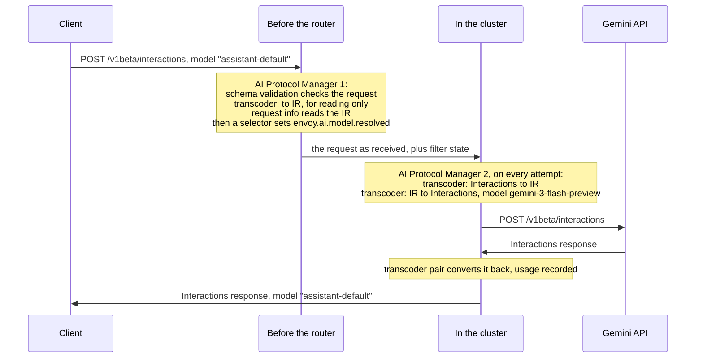

# Gemini Interactions in the AI Protocol Manager

Design only, no code. Base: upstream/main `e320af5281` (2026-10-19).

## Summary

Envoy's AI filters should work on one request shape: the IR, or intermediate representation.
The transcoder converts the client's API into the IR. The AI filters work on the IR. Then the
transcoder converts the IR into the backend's API, and the response takes the same path back.

Today the IR is OpenAI Chat Completions, and it cannot hold everything a Gemini Interactions
request carries. This design does four things:

1. It extends the IR so Interactions converts into it and back without loss.
2. It adds Gemini Interactions as an API Envoy knows.
3. It runs schema validation first.
4. It splits the work between two AI Protocol Managers. One, before the router, reads the request
   and picks the model. The other, in the cluster, converts the request for the backend. Behind a
   dynamic forward proxy (DFP), the first also recognizes AI calls on a single `*` route.

The first release serves Gemini models, not agents, and lets the gateway change the model name.

## Principles

1. **AI filters work on the IR.** The exceptions are the transcoders, which convert, and schema
   validation, which checks what the client sent before it is converted.
2. **The IR loses nothing on a same-API hop.** A request that goes from API A into the IR and back
   to A comes out as it came in, except for intended edits such as the model. A request going from
   A to another API B keeps what B can express, and is refused when B cannot serve it.
3. **Convert only when needed.** A request needs the IR when an AI filter reads it, or when the
   backend speaks another API. Otherwise it is not converted, and only its model changes.

## What differs between Chat Completions and Interactions

| | Chat Completions | Interactions |
|---|---|---|
| Model | `model` | `model`, or `agent` instead |
| Instructions | `system` and `developer` messages | `system_instruction` |
| Conversation | `messages`, each with a `role` | `input`: a string, a content item, or a list of typed steps, with no roles |
| Reasoning | no field to send it back | `thought` steps with a `signature`, which Gemini needs back when thinking and tools mix |
| Tool calls | `tool_calls` on an assistant message, with arguments as a JSON string | `function_call` steps, with arguments as an object |
| Tool results | `tool` messages | `function_result` steps, with `is_error` |
| Server-side tools | none | search, code execution, URL context, file search, maps and MCP, whose calls and results are steps |
| Media | image, audio and file parts | image, audio, video and document content, by data or by URI |
| Generation | `max_completion_tokens`, `temperature`, `top_p`, `stop`, `seed`, `reasoning_effort` | `generation_config`: `max_output_tokens`, `stop_sequences`, `seed`, `thinking_level`, `thinking_summaries` |
| Server-side state | none: `store` keeps a copy for OpenAI's evals, not the conversation | `store` (true by default), `previous_interaction_id`, `background` |
| Response | `choices[].message`, `finish_reason` | `steps[]`, `status` |
| Usage | `completion_tokens` includes reasoning | `total_output_tokens` and `total_thought_tokens` are separate |
| Stream | unnamed chunks, ending in `data: [DONE]` | named events (`interaction.created`, `step.start`, `step.delta`, `step.stop`, `interaction.completed`, `error`), ending in `event: done` and `data: [DONE]` |

Converting Interactions into Chat Completions would lose three things:

- **Thoughts and their signatures.** Gemini needs them back in later turns; its error codes include
  `missing_thought_signature`.
- **Server-side state and tools.** `previous_interaction_id`, `store`, and server-side tool steps
  are dropped.
- **Shape details.** Media by URI, `is_error`, and the stream's step structure are dropped.

So the IR cannot stay plain Chat Completions.

## The IR

The IR keeps the shape of Chat Completions. Chat clients therefore convert for free, and today's
Anthropic and Gemini conversions keep working. What the IR adds is one reserved member, `_envoy`,
which any element may carry: the request, a message, a response, or a stream chunk.

| Member | Holds | Comes from |
|---|---|---|
| `_envoy.reasoning`, on an assistant message or a stream delta | The model's thoughts in order, each `{text, signature}`; defined for every API | Interactions `thought` steps; later Anthropic `thinking` blocks and Gemini `thought` parts |
| `_envoy.<API name>`, on any element | What only that API has | e.g. `{"GEMINI_INTERACTIONS": {"store": false}}` |

The rules:

1. **One element stays one element.** One source element becomes one IR element: a step becomes a
   message, and an event becomes a chunk. Their order is kept.
2. **Mapped members go in IR fields.** What the IR has a field for goes in that field, where AI
   filters can read and edit it.
3. **The rest goes in `_envoy.<API>`.** Converting back to the same API rebuilds the element from
   its IR fields, filter edits included, plus what `_envoy.<API>` kept.
4. **Another API leaves `_envoy.<API>` behind.** Where leaving it would change the meaning, as
   `previous_interaction_id` or `agent` would, the request is refused instead.
5. **Only Envoy writes `_envoy`, and it never leaves Envoy.** A client's request and a backend's
   response lose any `_envoy` they arrive with. Otherwise a Chat client, whose request already is
   the IR, could forge thoughts or another API's fields. Before sending, the AI Protocol Manager
   removes `_envoy`, and drops a stream chunk that holds nothing else.

An Interactions request:

```json
{"model": "assistant-default", "system_instruction": "Be concise.",
 "input": [
   {"type": "user_input", "content": [{"type": "text", "text": "Plan a trip."}]},
   {"type": "thought", "signature": "Cs4B...", "summary": [{"type": "text", "text": "Ask where."}]},
   {"type": "model_output", "content": [{"type": "text", "text": "Where to?"}]},
   {"type": "user_input", "content": [{"type": "text", "text": "Paris."}]}],
 "generation_config": {"max_output_tokens": 256, "thinking_level": "low"},
 "store": false}
```

Its IR:

```json
{"model": "assistant-default",
 "messages": [
   {"role": "system", "content": "Be concise."},
   {"role": "user", "content": [{"type": "text", "text": "Plan a trip."}]},
   {"role": "assistant", "content": null,
    "_envoy": {"reasoning": [{"text": "Ask where.", "signature": "Cs4B..."}]}},
   {"role": "assistant", "content": [{"type": "text", "text": "Where to?"}]},
   {"role": "user", "content": [{"type": "text", "text": "Paris."}]}],
 "max_completion_tokens": 256,
 "reasoning_effort": "low",
 "_envoy": {"GEMINI_INTERACTIONS": {"store": false}}}
```

Converting this IR back to Interactions gives the client's request again, with the gateway's model
if one is set.

### Gemini Interactions and the IR

| Interactions | IR |
|---|---|
| `system_instruction` | a `system` message |
| `user_input` step | a `user` message |
| `model_output` step | an `assistant` message with `content` |
| `thought` step | an `assistant` message with `_envoy.reasoning` |
| any other step: function calls and results, server-side tools, for now | a message holding the step in `_envoy.GEMINI_INTERACTIONS` |
| `generation_config.max_output_tokens`, `stop_sequences`, `seed` | `max_completion_tokens`, `stop`, `seed` |
| `generation_config.thinking_level` | `reasoning_effort`: same values, `minimal` to `high` |
| `model`, `stream` | `model`, `stream` |
| `store`, `previous_interaction_id`, `background`, `agent`, `tools`, anything else | `_envoy.GEMINI_INTERACTIONS` |
| response `steps` | `choices[0].message`: `content` from `model_output`, `_envoy.reasoning` from `thought` |
| response `status` | `finish_reason`: `completed` is `stop`, `incomplete` is `length` |
| response `usage` | IR `usage`, with output including thought tokens |
| stream event | one chunk: `step.delta` text as `delta.content`, thought deltas as `delta._envoy.reasoning`, `interaction.completed` as the closing chunk with usage; other events carry only `_envoy` |

A chunk that carries only `_envoy` becomes an Interactions event again for an Interactions
client, and is dropped for any other (rule 5).

### When to convert

A conversion is needed only when a filter reads the IR, or when the backend speaks another API:

| Backend speaks | An AI filter reads the IR | The client-side transcoder |
|---|---|---|
| another API | either | converts |
| the client's API | yes | converts; nothing is lost |
| the client's API | no | does not convert; the backend side only writes the model |

To know whether a filter reads the IR, filters declare it, the way they declare the bindings they
apply today (`AiFilter::bindingUse()`). Until then, the transcoder pair always converts, which is
correct once the IR loses nothing.

## Two AI Protocol Managers

The work splits in two around the router. The model has to be picked before the router, which
picks the backend from it. The conversion has to happen after, once per attempt, for the host that
attempt goes to.



| | AI Protocol Manager 1, before the router | AI Protocol Manager 2, in the cluster |
|---|---|---|
| Runs | once per request | once per attempt, after the host is picked |
| AI filters | schema validation; the transcoder, request side, `TO_IR` only; request info. The model selector runs right after them. | the transcoder pair; IR filters such as guardrails go between them |
| The request body | forwarded as received: `reserialize_body: DISABLE` | converted for the backend |
| Filter state | writes the API, the client's model and the selector's choices | reads them |
| The response | not touched | converted back, and its usage recorded |

- **The second follows the first.** The first records the API it found in
  `envoy.ai.llm_protocol.request`, and the second takes it from there (see [Which requests are AI
  calls](#which-requests-are-ai-calls)). So the second needs no route config, except where its
  backend differs from the client's API, such as a Vertex AI path.
- **The selector.** Today it can be an external service behind ext_proc. It reads the request
  info and answers in dynamic metadata, which `set_filter_state` copies into
  `envoy.ai.model.resolved`. Later it can be an AI filter in the first AI Protocol Manager.
- **Filter names.** When both read route config, give the second its own filter name, e.g.
  `vertex.ai_protocol_manager`, so each has its own entry in `typed_per_filter_config`.
- **Two costs, both follow-ups.** The request is parsed twice: the second does not reuse the first's
  parse yet. And the first has no response role, but today it still parses and rewrites the
  response of every request it parsed. It should leave a response alone when no AI filter handles
  it.

## Recognizing AI calls behind a DFP

Behind a DFP, a single `*` route takes all traffic, and nothing on it says which requests are AI
calls. So the first AI Protocol Manager decides per request, from the request itself, and the
second follows it.

### Which requests are AI calls

A request runs the AI filters when one of these names its API. When several do, the first wins:

1. **Filter state.** A filter ahead, such as ext_proc, `set_filter_state` or a model router, sets
   `envoy.ai.llm_protocol.request`. Today this counts only on a route that declares `request`;
   here it counts on any route. A filter ahead can therefore make a call an AI call, or correct
   the API recognition would pick.
2. **The route.** The route declares an API in its AI config, as today.
3. **Recognition.** The AI Protocol Manager recognizes it. The request must be a `POST` with a JSON
   body, and its path must be one a listed API uses.

The other instructions in filter state apply to every AI call, however it was found:

- `envoy.ai.llm_protocol.response` names the backend's API;
- `envoy.ai.binding.request` and `envoy.ai.binding.response` name the bindings;
- `envoy.ai.model.resolved` names the model to send.

Each API is recognized by how its path ends, so gateway prefixes still match:

| API | Path ends with |
|---|---|
| `GEMINI_INTERACTIONS` | `/interactions`: `/v1beta/interactions`, `/v1/interactions`, and Vertex AI's `.../locations/global/interactions` |
| `GEMINI_GENERATE_CONTENT` | `:generateContent` or `:streamGenerateContent` |
| `OPENAI_CHAT_COMPLETIONS` | `/chat/completions` |
| `ANTHROPIC_MESSAGES` | `/v1/messages`, or Vertex AI's `.../publishers/anthropic/models/{model}:rawPredict` and `:streamRawPredict` |

These come from schema validation's path detection and the transcoder's built-in bindings, such
as Claude on Vertex AI's. The table moves into the AI Protocol Manager, which needs the API before
it decides to hold the body.

With `parse_unconfigured_routes` off, its default, everything else passes untouched, and is
neither held nor parsed:

- a get or a delete, which has no body;
- a cancel, whose path ends in `/cancel`;
- a file upload, whose path names no API;
- a call of an API that is not listed.

### What the recognized API decides

- **The client's API.** The recognized API is the client's API for every AI filter.
- **The backend's API.** It defaults to the client's, since behind a DFP the host serves the API
  the client called. A filter ahead can still name another with `envoy.ai.llm_protocol.response`.
  Today, a route that declares no backend API makes the backend-side transcoder fail.
- **The record.** The AI Protocol Manager records the API of every AI call in
  `envoy.ai.llm_protocol.request`, unless a filter ahead already set it. The second AI Protocol
  Manager follows that record, and access logs can show it.
- **Responses.** Responses of recognized calls are converted and metered, as on a declared route.

### Why the APIs are listed

Listing an API sends all of its calls through the transcoders. Until an API converts to the IR and
back without loss, that would change its traffic: today's IR drops Anthropic thinking and tool-use
blocks from responses, for example. Chat Completions is safe to list, since it is the IR's shape.
Gemini Interactions is safe once its conversion lands. OpenAI Responses cannot be listed yet: it
has no conversion, so the transcoders would refuse its calls.

### By the payload, later

A path that names no listed API, such as a gateway's own `/llm`, could still be recognized by its
payload. The AI Protocol Manager would hold a JSON `POST`, parse it, and look for the markers
schema validation uses today. A payload that names no API is forwarded as received. This holds
every JSON `POST`, so it is an option, off by default.

## Schema validation

| Check | Where | Against |
|---|---|---|
| The client's request | The schema validation filter, first in the first AI Protocol Manager | The client's API, as recognized |
| The IR | Tests: every golden IR document | The IR schema: Chat Completions, plus `_envoy` |
| The backend's request | The backend-side transcoder, before sending; it does this today | The backend's API |

Schema validation runs first because it checks what the client sent, which the conversion
replaces. Detection by path moves out of it, into the AI Protocol Manager, which needs the API
before it holds the body. Schema validation keeps its other detection, by the `anthropic-version`
header and then the payload, for a route that declares `request` without naming an API.

## Examples

### 1. Same API, new model

The client sends the Interactions request shown in [The IR](#the-ir) to
`generativelanguage.googleapis.com`, through the DFP:

1. The first AI Protocol Manager recognizes Gemini Interactions from the method, the body and the
   path. Schema validation passes the request, and request info reads `assistant-default` from the
   IR. The body goes on as received.
2. The selector picks `gemini-3-flash-preview`, and `envoy.ai.model.resolved` is set.
3. The router sends the call to the DFP cluster, for the host the client named.
4. The second AI Protocol Manager converts the request to the IR and back, with
   `"model": "gemini-3-flash-preview"`.

Google's response goes back through the second AI Protocol Manager. The client sees
`"model": "assistant-default"`, and usage is recorded for `gemini-3-flash-preview`.

### 2. Streaming

Each event becomes one IR chunk and comes back as the same event:

| Interactions event | IR chunk |
|---|---|
| `interaction.created` | the opening chunk; `id` and `model` in IR fields, the rest in `_envoy` |
| `step.start`, `step.stop`, `interaction.status_update` | `_envoy` only |
| `step.delta`, text | `delta.content`; the step `index` in `_envoy` |
| `step.delta`, thought summary or signature | `delta._envoy.reasoning` |
| `interaction.completed` | the closing chunk: `finish_reason` and `usage` |
| `error` | an error chunk |
| `data: [DONE]` | the end of the stream |

### 3. No filter reads the IR

With only schema validation and the transcoder pair, a same-API request is not converted once
filters declare IR use. The request goes out as it came in, with the gateway's model.

### 4. Get, delete and cancel

The AI Protocol Manager does not recognize these: a get or a delete has no body, and a cancel's
path ends in `/cancel`. They are forwarded without AI processing. A get returns a stored
interaction, which can carry the usage of the request that created it, so that usage is not
counted twice.

## Configuration

Both examples use proposed pieces: `endpoint_recognition`, `GEMINI_INTERACTIONS`, and the second AI
Protocol Manager following filter state. With the proposed field removed, `GEMINI_GENERATE_CONTENT`
in place of the new value, and the CA path adjusted, both pass `envoy --mode validate` on a build of
`d5eb7030ad`. The config protos they use are the same on today's main.

### A DFP for any provider

One route sends everything to the DFP cluster. The first AI Protocol Manager, in the listener,
recognizes AI calls and reads them; an external selector picks the model; the second, in the
cluster, converts.

```yaml
static_resources:
  listeners:
  - name: ai_egress
    address:
      socket_address: {address: 0.0.0.0, port_value: 10000}
    filter_chains:
    - filters:
      - name: envoy.filters.network.http_connection_manager
        typed_config:
          "@type": type.googleapis.com/envoy.extensions.filters.network.http_connection_manager.v3.HttpConnectionManager
          stat_prefix: ai_egress
          route_config:
            name: egress
            virtual_hosts:
            - name: egress
              domains: ["*"]
              routes:
              # The only route. The AI Protocol Managers decide what is an AI call.
              - match: {prefix: /}
                route: {cluster: dfp, timeout: 300s}
                request_headers_to_remove: [accept-encoding]
          http_filters:
          # 1. Reads the request and leaves its findings in filter state. The body goes on as
          #    received.
          - name: envoy.filters.http.ai_protocol_manager
            typed_config:
              "@type": type.googleapis.com/envoy.extensions.filters.http.ai_protocol_manager.v3.AiProtocolManager
              request_handling:
                reserialize_body: DISABLE
                endpoint_recognition:
                  llm_protocols: [GEMINI_INTERACTIONS, OPENAI_CHAT_COMPLETIONS]
              filters:
              - name: envoy.http.ai_filters.schema_validation
                typed_config:
                  "@type": type.googleapis.com/envoy.extensions.http.ai_filters.schema_validation.v3.SchemaValidation
              - name: envoy.http.ai_filters.transcoder
                typed_config:
                  "@type": type.googleapis.com/envoy.extensions.http.ai_filters.transcoder.v3.Transcoder
                  request_handling: TO_IR
              - name: envoy.http.ai_filters.request_info
                typed_config:
                  "@type": type.googleapis.com/envoy.extensions.http.ai_filters.request_info.v3.RequestInfo
          # 2. Picks the model. Here an external service does it, from the request info.
          - name: envoy.filters.http.ext_proc
            typed_config:
              "@type": type.googleapis.com/envoy.extensions.filters.http.ext_proc.v3.ExternalProcessor
              grpc_service:
                envoy_grpc: {cluster_name: model_selector}
              processing_mode:
                request_header_mode: SEND
                response_header_mode: SKIP
              metadata_options:
                forwarding_namespaces: {typed: [envoy.ai.request_info]}
                receiving_namespaces: {untyped: [envoy.ai.selection]}
          - name: envoy.filters.http.set_filter_state
            typed_config:
              "@type": type.googleapis.com/envoy.extensions.filters.http.set_filter_state.v3.Config
              on_request_headers:
              - object_key: envoy.ai.model.resolved
                skip_if_empty: true
                format_string:
                  omit_empty_values: true
                  text_format_source: {inline_string: "%DYNAMIC_METADATA(envoy.ai.selection:model)%"}
          # 3. Routes, to the host the client named.
          - name: envoy.filters.http.dynamic_forward_proxy
            typed_config:
              "@type": type.googleapis.com/envoy.extensions.filters.http.dynamic_forward_proxy.v3.FilterConfig
              dns_cache_config: {name: ai_providers, dns_lookup_family: V4_PREFERRED}
          - name: envoy.filters.http.router
            typed_config:
              "@type": type.googleapis.com/envoy.extensions.filters.http.router.v3.Router

  clusters:
  - name: dfp
    lb_policy: CLUSTER_PROVIDED
    cluster_type:
      name: envoy.clusters.dynamic_forward_proxy
      typed_config:
        "@type": type.googleapis.com/envoy.extensions.clusters.dynamic_forward_proxy.v3.ClusterConfig
        dns_cache_config: {name: ai_providers, dns_lookup_family: V4_PREFERRED}
    transport_socket:
      name: envoy.transport_sockets.tls
      typed_config:
        "@type": type.googleapis.com/envoy.extensions.transport_sockets.tls.v3.UpstreamTlsContext
        common_tls_context:
          validation_context:
            trusted_ca: {filename: /etc/ssl/certs/ca-certificates.crt}
    typed_extension_protocol_options:
      envoy.extensions.upstreams.http.v3.HttpProtocolOptions:
        "@type": type.googleapis.com/envoy.extensions.upstreams.http.v3.HttpProtocolOptions
        upstream_http_protocol_options: {auto_sni: true, auto_san_validation: true}
        auto_config:
          http_protocol_options: {}
          http2_protocol_options: {}
        # 4. Converts for the backend, on every attempt, following the filter state.
        http_filters:
        - name: envoy.filters.http.ai_protocol_manager
          typed_config:
            "@type": type.googleapis.com/envoy.extensions.filters.http.ai_protocol_manager.v3.AiProtocolManager
            request_handling: {}
            response_handling:
              token_usage: {}
            filters:
            - name: envoy.http.ai_filters.transcoder
              typed_config:
                "@type": type.googleapis.com/envoy.extensions.http.ai_filters.transcoder.v3.Transcoder
                request_handling: TO_IR
                response_handling: FROM_IR
            - name: envoy.http.ai_filters.transcoder
              typed_config:
                "@type": type.googleapis.com/envoy.extensions.http.ai_filters.transcoder.v3.Transcoder
                request_handling: FROM_IR
                response_handling: TO_IR
        - name: envoy.filters.http.upstream_codec
          typed_config:
            "@type": type.googleapis.com/envoy.extensions.filters.http.upstream_codec.v3.UpstreamCodec

  - name: model_selector
    type: STATIC
    load_assignment:
      cluster_name: model_selector
      endpoints:
      - lb_endpoints:
        - endpoint:
            address:
              socket_address: {address: 127.0.0.1, port_value: 9000}
    typed_extension_protocol_options:
      envoy.extensions.upstreams.http.v3.HttpProtocolOptions:
        "@type": type.googleapis.com/envoy.extensions.upstreams.http.v3.HttpProtocolOptions
        explicit_http_config:
          http2_protocol_options: {}
```

- Clients send plain HTTP with the provider's host, as through an egress sidecar. The DFP resolves
  the host, and Envoy originates TLS (`auto_sni`, `auto_san_validation`). Clients bring their own
  provider keys.
- The selector picks the model, not the provider: `auto_sni` follows the Host header, so a selector
  that sent a call elsewhere would have to change that header too.
- `accept-encoding` is removed on the route, so for all traffic, because Envoy can neither read nor
  convert a compressed response.
- Request info reads the IR once PR 5 lands. Until then, put it before the transcoder in the first
  AI Protocol Manager. It reads each API natively today, and the transcoder does not relabel the
  request's API after converting, so after it, request info would misread the IR.

### Gemini on Vertex AI, one DNS cluster

The same pattern, with one DNS cluster to Vertex AI instead of the DFP. Clients call Gemini API
paths such as `/v1beta/interactions`, and Vertex AI serves the Interactions API at a project path.
The listener's filters are the DFP example's, without the DFP filter; the route and the cluster
change:

```yaml
          route_config:
            name: vertex
            virtual_hosts:
            - name: gemini
              domains: ["*"]
              request_headers_to_remove: [authorization, accept-encoding]
              routes:
              # Interactions calls, sent to Gemini on Vertex AI.
              - match:
                  safe_regex: {regex: "/v1(beta)?/interactions"}
                  headers: [{name: ":method", string_match: {exact: POST}}]
                route: {cluster: vertex_ai, auto_host_rewrite: true, timeout: 300s}
                typed_per_filter_config:
                  # For the first AI Protocol Manager: the client speaks Interactions.
                  envoy.filters.http.ai_protocol_manager:
                    "@type": type.googleapis.com/envoy.extensions.filters.http.ai_protocol_manager.v3.AiProtocolManagerPerRoute
                    request: {llm_protocol: GEMINI_INTERACTIONS}
                  # For the second, in the cluster: so does the backend, at Vertex AI's path.
                  vertex.ai_protocol_manager:
                    "@type": type.googleapis.com/envoy.extensions.filters.http.ai_protocol_manager.v3.AiProtocolManagerPerRoute
                    response:
                      llm_protocol: GEMINI_INTERACTIONS
                      binding: {uri_pattern: /v1beta1/projects/my-project/locations/global/interactions}
              # Get, delete and cancel, moved to Vertex AI's path; no AI config.
              - match:
                  safe_regex: {regex: "/v1(beta)?/interactions/.+"}
                route:
                  cluster: vertex_ai
                  auto_host_rewrite: true
                  timeout: 300s
                  regex_rewrite:
                    pattern: {regex: "^/v1(beta)?/interactions/"}
                    substitution: /v1beta1/projects/my-project/locations/global/interactions/

  clusters:
  - name: vertex_ai
    type: LOGICAL_DNS
    dns_lookup_family: V4_PREFERRED
    connect_timeout: 5s
    load_assignment:
      cluster_name: vertex_ai
      endpoints:
      - lb_endpoints:
        - endpoint:
            hostname: aiplatform.googleapis.com
            address:
              socket_address: {address: aiplatform.googleapis.com, port_value: 443}
    transport_socket:
      name: envoy.transport_sockets.tls
      typed_config:
        "@type": type.googleapis.com/envoy.extensions.transport_sockets.tls.v3.UpstreamTlsContext
        sni: aiplatform.googleapis.com
        common_tls_context:
          alpn_protocols: [h2]
          validation_context:
            trusted_ca: {filename: /etc/ssl/certs/ca-certificates.crt}
            match_typed_subject_alt_names:
            - san_type: DNS
              matcher: {exact: aiplatform.googleapis.com}
    typed_extension_protocol_options:
      envoy.extensions.upstreams.http.v3.HttpProtocolOptions:
        "@type": type.googleapis.com/envoy.extensions.upstreams.http.v3.HttpProtocolOptions
        explicit_http_config:
          http2_protocol_options: {}
        http_filters:
        # Vertex AI takes an OAuth access token; something outside Envoy refreshes it.
        - name: envoy.filters.http.credential_injector
          typed_config:
            "@type": type.googleapis.com/envoy.extensions.filters.http.credential_injector.v3.CredentialInjector
            overwrite: true
            credential:
              name: envoy.http.injected_credentials.generic
              typed_config:
                "@type": type.googleapis.com/envoy.extensions.http.injected_credentials.generic.v3.Generic
                credential: {name: vertex-access-token}
                header: authorization
                header_value_prefix: "Bearer "
        - name: vertex.ai_protocol_manager
          typed_config:
            "@type": type.googleapis.com/envoy.extensions.filters.http.ai_protocol_manager.v3.AiProtocolManager
            request_handling: {}
            response_handling:
              token_usage: {}
            filters:
            - name: envoy.http.ai_filters.transcoder
              typed_config:
                "@type": type.googleapis.com/envoy.extensions.http.ai_filters.transcoder.v3.Transcoder
                request_handling: TO_IR
                response_handling: FROM_IR
            - name: envoy.http.ai_filters.transcoder
              typed_config:
                "@type": type.googleapis.com/envoy.extensions.http.ai_filters.transcoder.v3.Transcoder
                request_handling: FROM_IR
                response_handling: TO_IR
        - name: envoy.filters.http.upstream_codec
          typed_config:
            "@type": type.googleapis.com/envoy.extensions.filters.http.upstream_codec.v3.UpstreamCodec
```

- The route has an entry for each AI Protocol Manager, under its filter name. The first learns the
  client's API. The second learns the backend's binding, which renders Vertex AI's path for the
  converted request.
- Get, delete and cancel carry no AI config. A path rewrite moves them to Vertex AI's path.
- Vertex AI takes an OAuth access token rather than an API key. Here it comes from a secret that
  something outside Envoy refreshes.

## Changes

| PR | Change |
|---|---|
| 1. `ai_protocol_manager: add the Gemini Interactions protocol` | `GEMINI_INTERACTIONS = 5`; the Interactions request schema; usage from unary and streamed responses (output plus thought tokens, read at `interaction.completed`); the path suffix `/interactions` in schema validation's detection, and a fix for bodies it reads today as `generateContent`; request info's Interactions reader |
| 2. `ai_protocol_manager: recognize AI calls without route config` | `RequestHandling.endpoint_recognition`, listing the APIs to recognize. A request is an AI call when `envoy.ai.llm_protocol.request` names its API, on any route; when its route declares one; or when recognition does. The first of these wins. The path table moves in from schema validation. The backend API defaults to the client's. Responses of recognized calls are converted and metered. The API of every AI call is recorded in `envoy.ai.llm_protocol.request`, which a second AI Protocol Manager follows. |
| 3. `ai_protocol_manager: carry what the IR has no field for` | The `_envoy` member: engine rules that move unmapped members into `_envoy.<API>` and back. The AI Protocol Manager drops any `_envoy` a client or backend sends, removes `_envoy` before sending, and drops a stream chunk left with nothing else. The IR schema accepts it. |
| 4. `ai_protocol_manager: transcode Gemini Interactions to and from the IR` | Request, response and stream, in both directions: text, instructions, generation settings and thoughts; everything else in `_envoy`; the gateway's model on the way out and the client's on the way back |
| 5. `request_info: read the IR` | One reader for every API, between the transcoders, in place of today's per-API readers |

PR 1 stands alone, and PR 2 makes the two-AI-Protocol-Manager pattern and the single DFP route
work. PRs 3 and 4 are the IR work, and PR 5 depends on them. Later:

- recognition by payload;
- skipping the conversion when nothing reads the IR;
- the second AI Protocol Manager reusing the first's parse;
- the first leaving a response alone when no AI filter handles it;
- an AI filter for picking the model, in place of ext_proc;
- the Anthropic and Gemini conversions carrying thoughts and unmapped members the same way;
- tools and media.

Tests come with each PR. They include round-trip goldens: every Interactions request, response
and stream event goes into the IR and back unchanged, and every golden IR document passes the IR
schema. PR 2's integration test runs both examples:

- an Interactions call is recognized by the first AI Protocol Manager, and converted and metered by
  the second;
- the Vertex AI route renders the project path;
- a get, a cancel and a file upload pass untouched.

## Limits of the first release

- **Agents.** An `agent` request is carried through. When a model is set for it, it is refused,
  because it would then name both a model and an agent.
- **Tools and media.** Same-API requests carry them, held in `_envoy`, but they are not converted
  to other APIs yet.
- **Other APIs.** The Anthropic and Gemini conversions do not map the fields Interactions fills in
  the IR yet. `reasoning_effort` reaches those APIs as is, and they reject it, as they do for a
  Chat client's today.
- **Recognition is by path.** A call on a gateway path that names no API is not an AI call until
  recognition by payload exists.
- **Get, delete and cancel.** These calls are not recognized, and are forwarded without AI
  processing or usage records.

## Decisions

- **The IR's form** (2026-10-19): Chat Completions' shape plus `_envoy`. A new Envoy-defined
  format would be cleaner, but every conversion would be rewritten, and Chat clients would convert
  too.

## Open questions

1. **Where thoughts live.** `_envoy.reasoning` cannot clash with a future OpenAI field. Other
   gateways put thoughts in a top-level field, such as `reasoning_content` or `reasoning_details`.
2. **Converting only when needed.** Should filters declare that they read the IR, or should the
   transcoder pair always convert?
3. **State-bound fields.** Should a cross-API request carrying `previous_interaction_id` or `agent`
   be refused? Doing so needs a refuse rule in the engine.
4. **Which APIs recognition takes.** This design lists them in the config. Should every API whose
   conversion loses nothing be recognized by default instead?
5. **`accept-encoding`.** Should the AI Protocol Manager remove it only from the calls it takes,
   instead of the route removing it from all traffic?

## References

- Interactions API: https://ai.google.dev/api/interactions-api and
  https://ai.google.dev/api/interactions-api-v1
- Streaming: https://ai.google.dev/gemini-api/docs/streaming
- Errors, including `missing_thought_signature`: https://ai.google.dev/gemini-api/docs/api-errors
