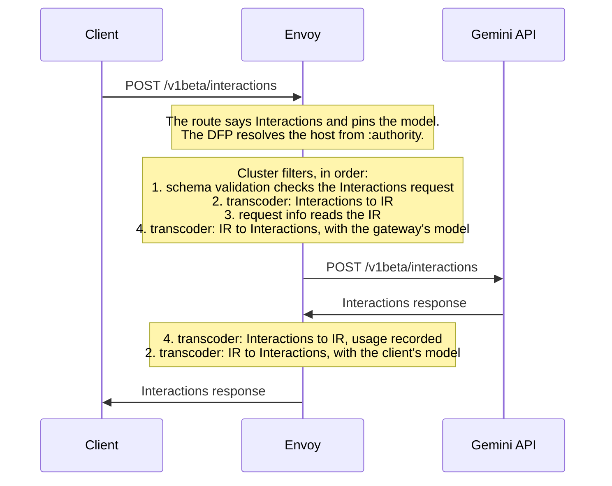

# Gemini Interactions in the AI Protocol Manager

Design only, no code. Base: upstream/main `d7b74bd624` (2026-10-19).

## Summary

Envoy's AI filters should work on one request shape: the IR, or intermediate representation.
The transcoder converts the client's API into the IR. The AI filters work on the IR. Then the
transcoder converts the IR into the backend's API, and the response takes the same path back.

Today the IR is OpenAI Chat Completions, and it cannot hold everything a Gemini Interactions
request carries. This design does four things:

1. It extends the IR so Interactions converts into it and back without loss.
2. It adds Gemini Interactions as an API Envoy knows.
3. It runs schema validation first.
4. It makes the flow work behind a dynamic forward proxy (DFP), where the API is detected per
   request.

The first release serves Gemini models, not agents, and lets the gateway change the model name.

## Principles

1. **AI filters work on the IR.** Only schema validation reads the client's own API: it checks
   what the client sent, before that is converted.
2. **The IR loses nothing on a same-API hop.** A request that goes from API A into the IR and back
   to A comes out as it came in, except for intended edits such as the model. A request going from
   A to another API B keeps what B can express, and is refused when B cannot serve it.
3. **Convert only when needed.** A request needs the IR when an AI filter reads it, or when the
   backend speaks another API. Otherwise it is not converted, and only its model changes.

## What differs between Chat Completions and Interactions

| | Chat Completions | Interactions |
|---|---|---|
| Model | `model` | `model`, or `agent` instead |
| Instructions | `system` and `developer` messages | `system_instruction` |
| Conversation | `messages`, each with a `role` | `input`: a string, a content item, or a list of typed steps, with no roles |
| Reasoning | no field to send it back | `thought` steps with a `signature`, which Gemini needs back when thinking and tools mix |
| Tool calls | `tool_calls` on an assistant message, with arguments as a JSON string | `function_call` steps, with arguments as an object |
| Tool results | `tool` messages | `function_result` steps, with `is_error` |
| Server-side tools | none | search, code execution, URL context, file search, maps and MCP, whose calls and results are steps |
| Media | image, audio and file parts | image, audio, video and document content, by data or by URI |
| Generation | `max_completion_tokens`, `temperature`, `top_p`, `stop`, `seed`, `reasoning_effort` | `generation_config`: `max_output_tokens`, `stop_sequences`, `seed`, `thinking_level`, `thinking_summaries` |
| Server-side state | none | `store` (true by default), `previous_interaction_id`, `background` |
| Response | `choices[].message`, `finish_reason` | `steps[]`, `status` |
| Usage | `completion_tokens` includes reasoning | `total_output_tokens` and `total_thought_tokens` are separate |
| Stream | unnamed chunks, ending in `data: [DONE]` | named events (`interaction.created`, `step.start`, `step.delta`, `step.stop`, `interaction.completed`, `error`), ending in `event: done` and `data: [DONE]` |

Converting Interactions into Chat Completions would lose three things:

- **Thoughts and their signatures.** Gemini needs them back in later turns; its error codes include
  `missing_thought_signature`.
- **Server-side state and tools.** `previous_interaction_id`, `store`, and server-side tool steps
  are dropped.
- **Shape details.** Media by URI, `is_error`, and the stream's step structure are dropped.

So the IR cannot stay plain Chat Completions.

## The IR

The IR keeps the shape of Chat Completions. Chat clients therefore convert for free, and today's
Anthropic and Gemini conversions keep working. What the IR adds is one reserved member, `_envoy`,
which any element may carry: the request, a message, a response, or a stream chunk.

| Member | Holds | Comes from |
|---|---|---|
| `_envoy.reasoning`, on an assistant message or a stream delta | The model's thoughts in order, each `{text, signature}`; defined for every API | Interactions `thought` steps; later Anthropic `thinking` blocks and Gemini `thought` parts |
| `_envoy.<API name>`, on any element | What only that API has | e.g. `{"GEMINI_INTERACTIONS": {"store": false}}` |

The rules:

1. **One element stays one element.** One source element becomes one IR element: a step becomes a
   message, and an event becomes a chunk. Their order is kept.
2. **Mapped members go in IR fields.** What the IR has a field for goes in that field, where AI
   filters can read and edit it.
3. **The rest goes in `_envoy.<API>`.** Converting back to the same API rebuilds the element from
   its IR fields, filter edits included, plus what `_envoy.<API>` kept.
4. **Another API leaves `_envoy.<API>` behind.** Where leaving it would change the meaning, as
   `previous_interaction_id` or `agent` would, the request is refused instead.
5. **`_envoy` never leaves Envoy.** The AI Protocol Manager removes it before sending.

An Interactions request:

```json
{"model": "assistant-default", "system_instruction": "Be concise.",
 "input": [
   {"type": "user_input", "content": [{"type": "text", "text": "Plan a trip."}]},
   {"type": "thought", "signature": "Cs4B...", "summary": [{"type": "text", "text": "Ask where."}]},
   {"type": "model_output", "content": [{"type": "text", "text": "Where to?"}]},
   {"type": "user_input", "content": [{"type": "text", "text": "Paris."}]}],
 "generation_config": {"max_output_tokens": 256, "thinking_level": "low"},
 "store": false}
```

Its IR:

```json
{"model": "assistant-default",
 "messages": [
   {"role": "system", "content": "Be concise."},
   {"role": "user", "content": [{"type": "text", "text": "Plan a trip."}]},
   {"role": "assistant", "content": null,
    "_envoy": {"reasoning": [{"text": "Ask where.", "signature": "Cs4B..."}]}},
   {"role": "assistant", "content": [{"type": "text", "text": "Where to?"}]},
   {"role": "user", "content": [{"type": "text", "text": "Paris."}]}],
 "max_completion_tokens": 256,
 "reasoning_effort": "low",
 "_envoy": {"GEMINI_INTERACTIONS": {"store": false}}}
```

Converting this IR back to Interactions gives the client's request again, with the gateway's model
if one is set.

### Gemini Interactions and the IR

| Interactions | IR |
|---|---|
| `system_instruction` | a `system` message |
| `user_input` step | a `user` message |
| `model_output` step | an `assistant` message with `content` |
| `thought` step | an `assistant` message with `_envoy.reasoning` |
| any other step: function calls and results, server-side tools, for now | a message holding the step in `_envoy.GEMINI_INTERACTIONS` |
| `generation_config.max_output_tokens`, `stop_sequences`, `seed` | `max_completion_tokens`, `stop`, `seed` |
| `generation_config.thinking_level` | `reasoning_effort`: same values, `minimal` to `high` |
| `model`, `stream` | `model`, `stream` |
| `store`, `previous_interaction_id`, `background`, `agent`, `tools`, anything else | `_envoy.GEMINI_INTERACTIONS` |
| response `steps` | `choices[0].message`: `content` from `model_output`, `_envoy.reasoning` from `thought` |
| response `status` | `finish_reason`: `completed` is `stop`, `incomplete` is `length` |
| response `usage` | IR `usage`, with output including thought tokens |
| stream event | one chunk: `step.delta` text as `delta.content`, thought deltas as `delta._envoy.reasoning`, `interaction.completed` as the closing chunk with usage; other events carry only `_envoy` |

A chunk that carries only `_envoy` is dropped for a client of another API.

### When to convert

A conversion is needed only when a filter reads the IR, or when the backend speaks another API:

| Backend speaks | An AI filter reads the IR | The client-side transcoder |
|---|---|---|
| another API | either | converts |
| the client's API | yes | converts; nothing is lost |
| the client's API | no | does not convert; the backend side only writes the model |

To know whether a filter reads the IR, filters declare it, the way they declare the bindings they
apply today (`AiFilter::bindingUse()`). Until then, the transcoder pair always converts, which is
correct once the IR loses nothing.

## The flow behind a DFP



Behind a DFP, one route can take any AI API, so the API is detected per request. Two things are
missing on main today:

- **The transcoder ignores the detected API.** Schema validation records what it detects in
  `AiRequest::protocol()`. The transcoder reads the route's or the filter state's API instead,
  which on a catch-all route is unset.
- **The backend API has no default.** With no backend API declared, the backend-side transcoder
  fails. Behind a DFP, the host serves the client's API, so the client's API should be the default.

## Schema validation

| Check | Where | Against |
|---|---|---|
| The client's request | The schema validation filter, first in the chain. Behind a DFP, it also names the API, from the path and then the payload. | The client's API |
| The IR | Tests: every golden IR document | The IR schema: Chat Completions, plus `_envoy` |
| The backend's request | The backend-side transcoder, before sending; it does this today | The backend's API |

Schema validation runs first for two reasons. It checks what the client sent, which the
conversion replaces. And behind a DFP, the transcoder needs the API it detects.

## Examples

### 1. Same API, new model

The client sends the Interactions request shown in [The IR](#the-ir) to
`generativelanguage.googleapis.com`, and the route pins `gemini-3-flash-preview`:

- Schema validation passes it.
- The client-side transcoder converts it to the IR.
- Request info reads `assistant-default` from the IR.
- The backend-side transcoder rebuilds the Interactions request with
  `"model": "gemini-3-flash-preview"`.

Google's response goes back the same way. The client sees `"model": "assistant-default"`, and
usage is recorded for `gemini-3-flash-preview`.

### 2. Streaming

Each event becomes one IR chunk and comes back as the same event:

| Interactions event | IR chunk |
|---|---|
| `interaction.created` | the opening chunk; `id` and `model` in IR fields, the rest in `_envoy` |
| `step.start`, `step.stop`, `interaction.status_update` | `_envoy` only |
| `step.delta`, text | `delta.content`; the step `index` in `_envoy` |
| `step.delta`, thought summary or signature | `delta._envoy.reasoning` |
| `interaction.completed` | the closing chunk: `finish_reason` and `usage` |
| `error` | an error chunk |
| `data: [DONE]` | the end of the stream |

### 3. No filter reads the IR

With only schema validation and the transcoder pair, a same-API request is not converted once
filters declare IR use. The request goes out as it came in, with the gateway's model.

### 4. Get, delete and cancel

These requests carry no AI config. A get returns a stored interaction, which can carry the usage
of the request that created it, so a configured route would count that usage twice.

## Configuration

`GEMINI_INTERACTIONS` does not exist yet, and both AI routes rely on the two DFP changes above.
With `GEMINI_GENERATE_CONTENT` in its place and the CA path adjusted, this file passes
`envoy --mode validate` on a build of `d5eb7030ad`.

```yaml
static_resources:
  listeners:
  - name: ai_egress
    address:
      socket_address: {address: 0.0.0.0, port_value: 10000}
    filter_chains:
    - filters:
      - name: envoy.filters.network.http_connection_manager
        typed_config:
          "@type": type.googleapis.com/envoy.extensions.filters.network.http_connection_manager.v3.HttpConnectionManager
          stat_prefix: ai_egress
          route_config:
            name: egress
            virtual_hosts:
            # Gemini: Interactions calls get the model the gateway picks.
            - name: gemini
              domains: [generativelanguage.googleapis.com]
              routes:
              - match:
                  safe_regex: {regex: "/v1(beta)?/interactions"}
                  headers: [{name: ":method", string_match: {exact: POST}}]
                route: {cluster: dfp, timeout: 300s}
                request_headers_to_remove: [accept-encoding]
                typed_per_filter_config:
                  envoy.filters.http.ai_protocol_manager:
                    "@type": type.googleapis.com/envoy.extensions.filters.http.ai_protocol_manager.v3.AiProtocolManagerPerRoute
                    request: {llm_protocol: GEMINI_INTERACTIONS}
                  envoy.filters.http.set_filter_state:
                    "@type": type.googleapis.com/envoy.extensions.filters.http.set_filter_state.v3.Config
                    on_request_headers:
                    - object_key: envoy.ai.model.resolved
                      format_string:
                        text_format_source: {inline_string: gemini-3-flash-preview}
              # Get, delete, cancel and anything else: plain forwarding, no AI config.
              - match: {prefix: /}
                route: {cluster: dfp, timeout: 300s}
            # Any other AI provider: schema validation names the API from the path.
            - name: any
              domains: ["*"]
              routes:
              - match:
                  safe_regex: {regex: ".*/(interactions|chat/completions|messages)"}
                  headers: [{name: ":method", string_match: {exact: POST}}]
                route: {cluster: dfp, timeout: 300s}
                request_headers_to_remove: [accept-encoding]
                typed_per_filter_config:
                  envoy.filters.http.ai_protocol_manager:
                    "@type": type.googleapis.com/envoy.extensions.filters.http.ai_protocol_manager.v3.AiProtocolManagerPerRoute
                    request: {}
              - match: {prefix: /}
                route: {cluster: dfp, timeout: 300s}
          http_filters:
          # Sets filter state only where a route configures it.
          - name: envoy.filters.http.set_filter_state
            typed_config:
              "@type": type.googleapis.com/envoy.extensions.filters.http.set_filter_state.v3.Config
          - name: envoy.filters.http.dynamic_forward_proxy
            typed_config:
              "@type": type.googleapis.com/envoy.extensions.filters.http.dynamic_forward_proxy.v3.FilterConfig
              dns_cache_config: {name: ai_providers, dns_lookup_family: V4_PREFERRED}
          - name: envoy.filters.http.router
            typed_config:
              "@type": type.googleapis.com/envoy.extensions.filters.http.router.v3.Router

  clusters:
  - name: dfp
    lb_policy: CLUSTER_PROVIDED
    cluster_type:
      name: envoy.clusters.dynamic_forward_proxy
      typed_config:
        "@type": type.googleapis.com/envoy.extensions.clusters.dynamic_forward_proxy.v3.ClusterConfig
        dns_cache_config: {name: ai_providers, dns_lookup_family: V4_PREFERRED}
    transport_socket:
      name: envoy.transport_sockets.tls
      typed_config:
        "@type": type.googleapis.com/envoy.extensions.transport_sockets.tls.v3.UpstreamTlsContext
        common_tls_context:
          validation_context:
            trusted_ca: {filename: /etc/ssl/certs/ca-certificates.crt}
    typed_extension_protocol_options:
      envoy.extensions.upstreams.http.v3.HttpProtocolOptions:
        "@type": type.googleapis.com/envoy.extensions.upstreams.http.v3.HttpProtocolOptions
        upstream_http_protocol_options: {auto_sni: true, auto_san_validation: true}
        auto_config:
          http_protocol_options: {}
          http2_protocol_options: {}
        # Runs once per attempt, after the host is resolved.
        http_filters:
        - name: envoy.filters.http.ai_protocol_manager
          typed_config:
            "@type": type.googleapis.com/envoy.extensions.filters.http.ai_protocol_manager.v3.AiProtocolManager
            request_handling: {}
            response_handling:
              token_usage: {}
            filters:
            # 1. Checks the request in the client's own API, and names the API.
            - name: envoy.http.ai_filters.schema_validation
              typed_config:
                "@type": type.googleapis.com/envoy.extensions.http.ai_filters.schema_validation.v3.SchemaValidation
            # 2. The client's API to the IR; on the way back, the IR to the client's API.
            - name: envoy.http.ai_filters.transcoder
              typed_config:
                "@type": type.googleapis.com/envoy.extensions.http.ai_filters.transcoder.v3.Transcoder
                request_handling: TO_IR
                response_handling: FROM_IR
            # 3. Works on the IR.
            - name: envoy.http.ai_filters.request_info
              typed_config:
                "@type": type.googleapis.com/envoy.extensions.http.ai_filters.request_info.v3.RequestInfo
            # 4. The IR to the backend's API, with the gateway's model; on the way back, to the IR.
            - name: envoy.http.ai_filters.transcoder
              typed_config:
                "@type": type.googleapis.com/envoy.extensions.http.ai_filters.transcoder.v3.Transcoder
                request_handling: FROM_IR
                response_handling: TO_IR
        - name: envoy.filters.http.upstream_codec
          typed_config:
            "@type": type.googleapis.com/envoy.extensions.filters.http.upstream_codec.v3.UpstreamCodec
```

- Clients send plain HTTP with the provider's host, as through an egress sidecar. The DFP resolves
  the host and Envoy originates TLS (`auto_sni`, `auto_san_validation`). Clients bring their own
  provider keys.
- The Gemini route names its API and pins the model; the catch-all route leaves the API to
  schema validation. Neither declares a backend API, which then defaults to the client's.
- `accept-encoding` is removed because Envoy can neither read nor convert a compressed response.

## Changes

| PR | Change |
|---|---|
| 1. `ai_protocol_manager: add the Gemini Interactions protocol` | `GEMINI_INTERACTIONS = 5`; the Interactions request schema; usage from unary and streamed responses (output plus thought tokens, read at `interaction.completed`); detection by the path suffix `/interactions`, with a fix for bodies read today as `generateContent`; request info's Interactions reader |
| 2. `transcoder: follow the detected API behind a DFP` | The transcoder takes the client's API from `AiRequest::protocol()`, and the backend API defaults to the client's |
| 3. `ai_protocol_manager: carry what the IR has no field for` | The `_envoy` member: engine rules that move unmapped members into `_envoy.<API>` and back; the AI Protocol Manager removes `_envoy` before sending; the IR schema accepts it |
| 4. `ai_protocol_manager: transcode Gemini Interactions to and from the IR` | Request, response and stream, in both directions: text, instructions, generation settings and thoughts; everything else in `_envoy`; the gateway's model on the way out and the client's on the way back |
| 5. `request_info: read the IR` | One reader for every API, between the transcoders, in place of today's per-API readers |

PR 1 stands alone. PRs 3 and 4 are the IR work, and PR 5 depends on them. Later: skipping the
conversion when nothing reads the IR; the Anthropic and Gemini conversions carrying thoughts and
unmapped members the same way; tools; media.

Tests come with each PR. They include round-trip goldens: every Interactions request, response
and stream event goes into the IR and back unchanged, and every golden IR document passes the IR
schema.

## Limits of the first release

- **Agents.** An `agent` request is carried through. On a route that sets a model, it is refused,
  because it would then name both a model and an agent.
- **Tools and media.** Same-API requests carry them, held in `_envoy`, but they are not converted
  to other APIs yet.
- **Get, delete and cancel.** These calls are forwarded without AI processing or usage records.

## Open questions

1. **The IR's form.** This design keeps Chat Completions' shape plus `_envoy`. A new
   Envoy-defined format would be cleaner, but every conversion would be rewritten, and Chat
   clients would convert too.
2. **Where thoughts live.** `_envoy.reasoning` cannot clash with a future OpenAI field. Other
   gateways put thoughts in a top-level field, such as `reasoning_content` or `reasoning_details`.
3. **Converting only when needed.** Should filters declare that they read the IR, or should the
   transcoder pair always convert?
4. **State-bound fields.** Should a cross-API request carrying `previous_interaction_id` or `agent`
   be refused? Doing so needs a refuse rule in the engine.

## References

- Interactions API: https://ai.google.dev/api/interactions-api and
  https://ai.google.dev/api/interactions-api-v1
- Streaming: https://ai.google.dev/gemini-api/docs/streaming
- Errors, including `missing_thought_signature`: https://ai.google.dev/gemini-api/docs/api-errors
