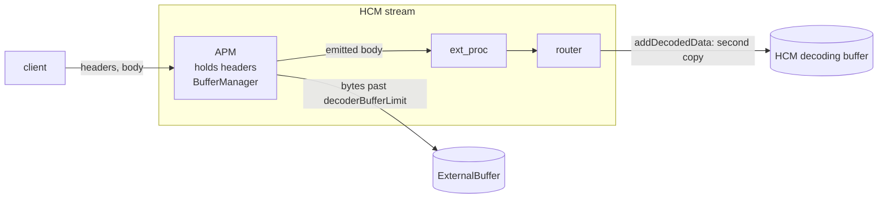
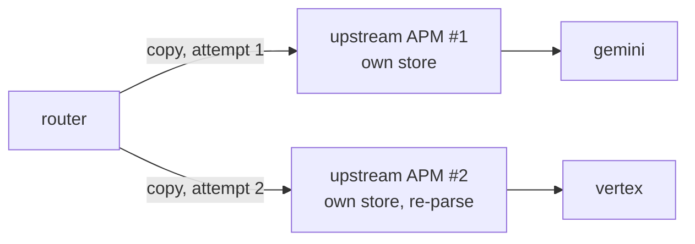
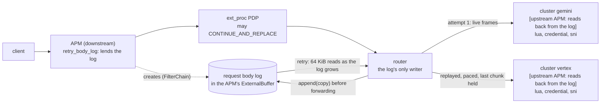
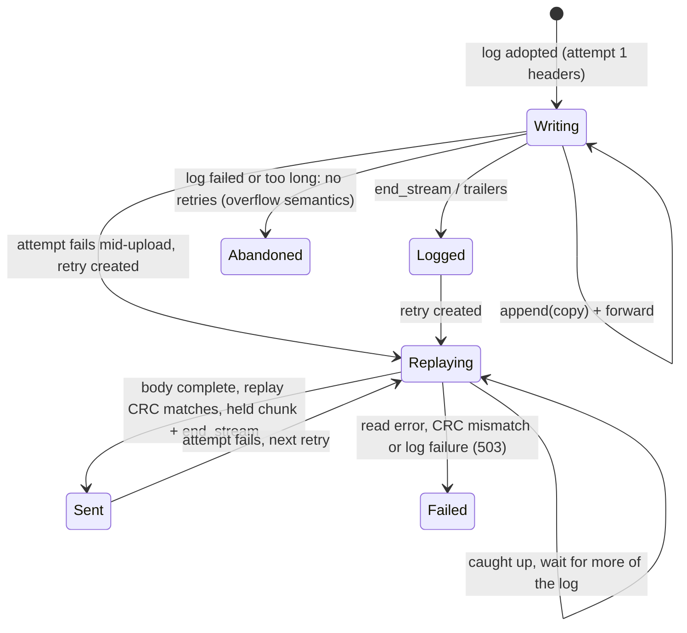

# Cross-cluster failover with the AI protocol manager's external buffer

Status: proposal with a working prototype on this branch. Code references are at upstream/main
`d7b74bd624` plus the prototype. Prototype line numbers are the ones on this branch.

Target topology:

```
client -> ai_protocol_manager (APM) -> ext_proc (routing PDP, may rewrite the body) -> router
          -> cluster gemini  [upstream APM?, ...] (generativelanguage.googleapis.com)
          -> cluster vertex  [upstream APM?, ...] (us-central1-aiplatform.googleapis.com)
```

## Summary

- **The retry body must be what the router sent, not what the downstream APM received.**
  - Anything between the two can change it: an ext_proc PDP answering `CONTINUE_AND_REPLACE`, a
    PDP that rewrites `model`, a redaction filter.
  - An earlier revision of this design (section 10) borrowed the downstream APM's bytes. It could
    only fail closed on such a rewrite.
- **Attempt 1's upstream APM sees the right bytes, but its buffer cannot hold the retry body.**
  - Its store dies with the attempt: a failed attempt's upstream filters are destroyed inside
    `deferredDelete`, before the retry exists.
  - When the attempt fails early, the store holds only a prefix.
- **Recommendation: a router-written request body log, kept in an APM's external buffer.**
  - A filter with an external buffer lends it as the stream's `Http::RequestBodyLog`. The APM does
    this with `retry_body_log`. Lending from the downstream APM is the recommended shape.
  - The router is the log's only writer. It appends every byte it sends before forwarding it, and
    keeps appending through backoff.
  - Each retry replays from the log as the log grows, holding the chunk that completes the request
    until the replay matches what the router received.
  - Upstream APMs read their payload back from the same log instead of storing a copy per attempt.
  - Every attempt therefore gets exactly the router's bytes, whatever filters ahead of it did, and
    however early attempt 1 failed.
  - The log is bounded (`retry_body_log_max_bytes`). A failed or overflowing log gives up on the
    retry the way today's buffer overflow does.
- **Cross-domain correctness rests on two independent layers.**
  - The router restores the request headers before each cross-cluster retry.
  - Each cluster's chain rebuilds its own path and credential and drops the other provider's,
    with a per-cluster SNI and `auto_host_rewrite`.
- **No custom retry policy is needed** (section 6).
- **Prototype results:**
  - 250/250 end-to-end checks on a real `envoy-static`, across five listeners and three lending
    shapes, including capacity limits.
  - 18/18 with header restore turned off.
  - The router, tcp_proxy, APM and priority_group test targets pass, plus 11 new unit tests.

## 1. How the APM external buffer works today

### 1.1 Downstream installation



- **Ingest.** `decodeHeaders` holds the headers. One `BufferManager` keeps the first
  `decoderBufferLimit()` bytes in memory (`filter.cc:342`) and the rest in the store.
  Unacknowledged bytes back-pressure the client.
- **Emission.** After the AI filters run, the APM emits either `store[0, len)` (`DISABLE`) or a
  serializer walk (`ALWAYS`). The bytes go through `injectDecodedDataToFilterChain` from the APM's
  position.
- **Lifetime.** The store lives until the APM's `onDestroy`. Reads do not consume it.
- **Why it cannot be the retry buffer.**
  - It holds the client's bytes, not the router's.
  - It cannot re-emit: anything injected after the end marker is dropped
    (`filter_manager.cc:776-778`).

### 1.2 Upstream installation



- **New instance per attempt.** Each attempt builds a new chain from its cluster
  (`upstream_request.cc:175`). A failed attempt is `deferredDelete`d, which synchronously runs
  `cleanUp()` and then `destroyFilters()` (`dispatcher_impl.cc:259`, `upstream_request.cc:199`).
  The store is gone before the retry is scheduled.
- **Early failure leaves a prefix.** The connection opens when the router sends the headers. A
  connect failure, reset or per-try timeout can end the attempt while the APM holds only a prefix.
- **Unpaced replay.** The upstream filter manager never forwards codec back-pressure to its
  `addUpstreamWatermarkCallbacks` subscribers (#46385 follow-up), so the APM's replay into the
  codec is unpaced.
- **Shared state.** Upstream filters share the downstream `StreamInfo`
  (`upstream_request.cc:56-61`), so filter state they set outlives the attempt.

### 1.3 What retries cost today

| Body size B vs. stream limit L | Router | APM | Result |
|---|---|---|---|
| B <= L | heap B | B in the in-memory tier | 2B resident; retry works |
| B > L | gives up (`retry_or_shadow_abandoned`) | B in the store | no retry |

## 2. Requirements

1. **Every attempt gets exactly the bytes the router received**, including when a filter between
   the APM and the router changes them.
2. **Retries survive an attempt that fails before the body was sent.**
3. **One durable copy per attempt, bounded.** It lives in the external buffer. Bodies larger than
   the stream limit stay retriable, up to a configured cap.
4. **Each attempt carries only its own cluster's settings**:

   | Cluster | Path | Credential | Host / SNI |
   |---|---|---|---|
   | gemini | `/v1beta/models/{m}:{method}` | `x-goog-api-key` | `generativelanguage.googleapis.com` |
   | vertex | `/v1/projects/{p}/locations/{l}/publishers/google/models/{m}:{method}` | `Authorization: Bearer` | `{region}-aiplatform.googleapis.com` |

5. **The PDP orders providers per request, and may rewrite the body.**
6. **Standard retry config:** `priority_group`, `refresh_cluster_on_retry`, `num_retries`.

## 3. Whose buffer can hold the retry body?

| Candidate | Right bytes? | Lives long enough? | Complete on early failure? | Verdict |
|---|---|---|---|---|
| Downstream APM's store | No, if a filter between it and the router changes the body | Yes | Yes | Only by verification, fails closed (section 10) |
| Attempt 1's upstream APM's own store | Yes | No: destroyed before the retry | No: may hold a prefix | Needs ownership moved out of the attempt, plus a writer for the tail |
| Router's decoding buffer (today) | Yes | Yes | Yes | Heap only, bounded by the stream limit |
| **A log the router writes, in an APM's external buffer** | **Yes, by construction** | **Yes: stream filter state** | **Yes: the router keeps appending** | **Recommended** |

This keeps the goal: the retry body lives in the APM's external buffer, and the upstream APM's
buffering serves the retry. It changes two things:
- **Ownership** moves to the stream, so the store outlives every attempt.
- **The writer** is the router, which sees every byte before, during and after any attempt fails.

## 4. Options

| Option | Summary | Verdict |
|---|---|---|
| A. Router in-memory buffer (today) | Raise `request_body_buffer_limit` | Two copies, no offload. Kept as the fallback when no log is lent |
| B. Router-owned spool | Router config names an external-buffer extension | Needs the external-buffer interface promoted to core plus router config. L covers it with storage lent by a filter |
| C+. Downstream-published body | Downstream APM publishes its emitted bytes; router replays them after a CRC check | One copy, but fails closed whenever a filter between them rewrites the body (section 10) |
| U. Upstream APM keeps its own store | Move attempt 1's store into filter state | Holds a prefix when attempt 1 fails early; nothing writes bytes during backoff |
| **L. Router-written log, storage lent by an APM** | Router writes and replays; an APM lends storage; upstream APMs read back from it | **Recommended** |
| D. Per-provider body rendering | An upstream APM renders per provider | Composes with L: it reads the log and renders per attempt |

## 5. Design (L)

### 5.1 Overview (recommended shape: the downstream APM lends)



```mermaid
sequenceDiagram
  participant Cl as client
  participant A as APM (downstream)
  participant L as request body log
  participant P as ext_proc PDP
  participant R as router
  participant G as gemini
  participant V as vertex
  Cl->>A: POST (4 MiB)
  A->>L: create in its ExternalBuffer (retry_body_log)
  A->>P: headers (after parsing; model in filter state)
  P-->>R: envoy.ai.routing + CONTINUE_AND_REPLACE(new body)
  R->>L: attachWriter (attempt 1 headers sent)
  loop body frames (the PDP's body)
    R->>L: append(copy)
    R->>G: frame
  end
  R->>L: end
  G-->>R: 429
  R->>R: restore headers; attempt 2 -> vertex
  loop until the last chunk
    R->>L: read(offset, 64 KiB)
    R->>V: previous chunk (newest held back)
  end
  R->>R: replay CRC == received CRC
  R->>V: held chunk + end_stream
  V-->>R: 200
  R-->>Cl: 200
```

### 5.2 Core contract: `Http::RequestBodyLog`

`envoy/http/request_body_log.h` defines a `StreamInfo::FilterState::Object` under the key
`envoy.http.request_body_log`:

| Member | Who | Meaning |
|---|---|---|
| `attachWriter(cb) -> Writer` | router | Become the only writer, before anything is appended; null if the log had a writer. Destroying the handle detaches it |
| `Writer::append(data)`, `Writer::end()` | router | The next body bytes; the end of the body |
| `WriterCallbacks` | router | `onLogAbove/BelowWatermark` for back-pressure; `onLogFailed` when the store failed or the body passed `maxLength()` |
| `writing()`, `failed()`, `maxLength()` | anyone | Whether the log will hold the whole body; whether it failed; its cap (0 for none) |
| `length()`, `ended()`, `crc32c()` | anyone | Appended bytes so far, and their CRC32C |
| `read(offset, max, cb)` | anyone | 1..max bytes once the store holds them; may complete inline; destroying the handle cancels |

Contract:
- A lender creates the log before the router's first body byte, with `LifeSpan::FilterChain`, so a
  recreated stream does not inherit it.
- A lender never replaces an existing log.
- Readers pin the log with `shared_ptr`.

### 5.3 Storage lenders: the APM

With `RequestHandling.retry_body_log` set, the APM looks for the log and creates an
`ExternalBufferRequestBodyLog` from its external buffer config if there is none
(`lendRetryBodyLog`, `filter.cc:372`).
- It does this as soon as it sees a request with a body (`filter.cc:299`), whether or not it
  inspects the request. A downstream APM can therefore lend storage alone.
- `retry_body_log_max_bytes` caps the log.

The log:
- creates its store on the first append;
- writes one batch at a time;
- back-pressures the writer above the lender's `decoderBufferLimit()`;
- serves reads up to the acknowledged length, and queues reads past it.

On a store error or an over-long body, the log:
- fails all readers;
- releases the writer's back-pressure;
- calls `onLogFailed` (`retry_body_log.cc:113`).

**Where to lend.**
- **Downstream APM (recommended).** The log exists before the router runs. Adoption then depends
  neither on which cluster attempt 1 picked nor on upstream filter timing. Use it with plain
  clusters (the Gemini/Vertex case: identical bodies) or with upstream APMs that read back from it.
- **Attempt 1's upstream APM (supported, constrained).** The router looks for the log right after
  attempt 1's `acceptHeadersFromRouter` (`router.cc:917`). So:
  - every cluster the route can reach first must have a lending APM, including clusters named
    inline in the PDP's override;
  - no upstream filter ahead of the APM may pause `decodeHeaders`.

  Otherwise that request falls back to today's in-memory buffer.

**Reading back in an upstream installation.**
- The APM's `BufferManager` stores through a `BorrowingExternalBufferFactory`
  (`retry_body_log.cc:251`). When the log is `writing()` and the body is known to fit, it hands out
  a `LogBackedExternalBuffer`.
- That buffer's writes keep nothing. They check that the router already appended the bytes; the
  final write checks length and CRC32C, and a mismatch logs which filter to move first.
- Its reads come back from the log.
- Bodies within the APM's in-memory tier never reach a store. A chunked body with a capped log
  keeps a private copy.

### 5.4 Router: write, then replay

**Adopt** (`maybeUseBodyLog`, `router.cc:2504`). The router attaches as the writer when all of
these hold:
- retries are enabled;
- there is no internal-redirect policy;
- there is no hedging;
- the request is not CONNECT or an upgrade;
- the request has a body;
- a log exists and has not failed;
- the Content-Length, when known, fits `maxLength()`.

Otherwise it keeps today's in-memory buffer.

**Write** (`decodeData`, `router.cc:1139`).
- Each frame extends the router's own CRC32C and is appended to the log as a copy, before it is
  forwarded.
- `end()` runs at `end_stream` or at the trailers.
- Log back-pressure pauses the client, and through the HCM fan-out the downstream APM too.
- Frames that arrive during backoff, or behind a replay, go to the log only.

**Replay** (`continueBodyReplay`, `router.cc:2583`).
- The replay reads `[offset, received)` in 64 KiB chunks, and keeps following the log while the
  body is still arriving.
- Each read sends the previous chunk and holds the newest one (`onBodyReplayRead`,
  `router.cc:2619`).
- Once the body is complete and the replay has caught up, `finishBodyReplay` (`router.cc:2659`)
  compares the replay CRC with the received CRC. Only then does it send the held chunk, with
  `end_stream` or followed by the trailers.
- So the bytes that complete the request never go out unverified, even on an HTTP/1.1
  Content-Length upstream.
- Pacing:
  - The replay pauses only on its own attempt's flow control, through
    `RouterFilterInterface::onUpstreamRequestBodyFlowControl`.
  - It resumes only if it actually stopped, so a pause and resume inside one send does not re-arm
    it.
  - After 8 chunks it cancels any pending activation and yields to the next event-loop pass.
- Failures:
  - A read error gives a 503 `retry_body_replay_error`.
  - A replay CRC mismatch gives a 503 `retry_body_replay_mismatch`.

**Log failure** (`handleBodyLogFailure`, `router.cc:2551`). It behaves like today's buffer overflow:
- the router counts `retry_body_log_failed` and `retry_or_shadow_abandoned`;
- it detaches as the writer and resets the retry state;
- a live attempt goes on with the router's own bytes, and its response, whatever it is, reaches the
  client;
- only a retry that is already waiting or replaying gets a 503.

**Other.**
- Generation and front-attempt checks make stale read callbacks no-ops.
- `onUpstreamComplete` resets an attempt whose response ends before its replay does.
- The global timeout is armed when a retry starts after the body ended during backoff.



### 5.5 Upstream-chain back-pressure

`UpstreamRequestFilterManagerCallbacks` now forwards the upstream filter manager's watermarks to
that manager's own subscribers (`upstream_request.h:342`), as the HCM does downstream. An upstream
APM's replay into the codec is then paced. This is the #46385 follow-up, and it applies to any
upstream APM, retries or not.

### 5.6 Per-attempt request adaptation

**Layer 1: router header restore.**
- When `cross_cluster_retry_` is set, the router copies the request headers before the first
  attempt's upstream filters run (`router.cc:909`).
- `doRetry` restores them with `clear()` and `copyFrom` (`router.cc:2727`), behind
  `envoy.reloadable_features.restore_request_headers_on_cross_cluster_retry`.

**Layer 2: self-normalizing cluster chains.** Each cluster's chain is:
1. the upstream APM, if any, first;
2. Lua, which rebuilds `:path` from the `/models/{m}:{method}` suffix and removes the other
   provider's credential;
3. `credential_injector` with `overwrite: true`;
4. `upstream_codec`.

**Route and clusters:**
- `auto_host_rewrite: true`;
- `request_headers_to_remove: [x-pdp-decision]`;
- `suppress_envoy_headers: true`;
- an explicit `sni` per cluster, never `auto_sni` or `auto_san_validation`;
- `circuit_breakers.max_retries` sized on both clusters.

### 5.7 PDP integration (ext_proc)

**Processing mode.** Header-only.

**Inputs.** `request_attributes: ["filter_state['envoy.ai.model.request']"]` sends the parsed model.

**Output.**
- `envoy.ai.routing` through `receiving_namespaces`.
- `route_cache_action: CLEAR`, with a mandatory header mutation.
- Optionally `CONTINUE_AND_REPLACE` with a body mutation. ext_proc then removes `content-length`,
  the router logs the PDP's body, and every attempt gets it.

### 5.8 What the CRC32C is for now

The log holds the router's own bytes, so detecting a rewrite before the router needs no checksum.
It remains as defense in depth:
1. **Replay readback.** It is checked before the bytes that complete the request go out.
2. **Upstream reads.** It checks that the upstream APM's frames match the log.

It costs about 0.2 ms per 4 MiB.

### 5.9 Failure modes

| Event | Behavior |
|---|---|
| PDP replaces the body, or Lua rewrites it, before the router | Logged as the router sent it; every attempt gets the same bytes |
| Attempt 1 fails while the body is still streaming | The router keeps appending; the retry follows the log and completes |
| Frames arrive during backoff | Appended to the log |
| Body longer than the cap, Content-Length known | Not adopted; the in-memory buffer decides, as today |
| Body longer than the cap, chunked | Log fails at the cap; retries given up; attempt 1's own response reaches the client |
| Store write fails | Same as the previous row |
| Store returns wrong bytes on readback | Replay CRC mismatch; held chunk withheld; 503 |
| Filter ahead of the upstream APM changes the body | That APM's final write fails, logged with which filter to move; above the in-memory tier only, the attempt ends with that APM's 500 |
| Router does not adopt (no retries, hedging, redirect, too long) | Upstream APMs keep private stores, as today |
| No lender | Today's in-memory retry buffer |

### 5.10 Costs

- **Memory.**
  - The log holds one bounded copy.
  - A downstream APM that also inspects the request keeps its own copy until stream end. Releasing
    it after emission is a follow-up.
  - Upstream APMs add at most their in-memory tier.
- **First-attempt throughput.** With a downstream lender, attempt 1's body is paced by the log's
  write rate. Every request with B > L pays this, retried or not, at about min(store bandwidth,
  window / write latency). With an upstream lender, the log replaces the APM's own store write.
- **Upstream APM.** It adds a second header hold, a re-parse and a store read-back per attempt.
  Configure one only where it renders or edits the body per provider. Gemini and Vertex take the
  same bytes, so plain clusters are the better fit there.

## 6. Do we need a custom retry policy?

No:

| Need | Mechanism |
|---|---|
| Per-attempt cluster order | `priority_group` + `refresh_cluster_on_retry` |
| Per-request order | PDP metadata through `override_metadata_namespace` |
| When to retry | `retry_on: 5xx,reset,connect-failure,retriable-status-codes` + `retriable_status_codes: [429]` |
| Keep one provider's `Retry-After` from delaying the other | Leave `rate_limited_retry_back_off` unset |
| Attempt count | `num_retries` |
| Retain and replay the body | Router + request body log |
| Per-provider request | Cluster upstream filters |

## 7. Prototype

**Code:**
- `envoy/http/request_body_log.h`;
- the `RouterFilterInterface` hook, its mock, and the tcp_proxy `CombinedUpstream` override;
- APM: `retry_body_log.{h,cc}`, `filter.{h,cc}`, and the proto fields `retry_body_log` and
  `retry_body_log_max_bytes`;
- router: `router.{h,cc}` and `upstream_request.{h,cc}`;
- stats: `retry_body_logged`, `retry_body_log_failed`, `retry_body_replay_error`,
  `retry_body_replay_mismatch`;
- the runtime guard;
- 11 unit tests in `retry_body_log_test.cc`.

The earlier C+ prototype is in `experiment/retry-buffer-failover/c_plus_prototype.patch`.

**Harness** (`experiment/retry-buffer-failover/`):

| Listener | Log lent by | Clusters |
|---|---|---|
| :19000 | each provider cluster's upstream APM (attempt 1) | gemini/vertex with APM |
| :19004 | the downstream APM (re-serializing) | `*_plain`, no APM |
| :19006 | the downstream APM; upstream APMs read back | gemini/vertex with APM |
| :19008 | as :19006, with a 1 MiB cap | gemini/vertex with APM |
| :19002 | none (control) | `*_plain` |

**Results** (`captured/`). The first five rows ran on each of :19000, :19004 and :19006:

| Case | Result |
|---|---|
| 429, 503 and reset failover; 1 KiB, 4 MiB, 4 MiB chunked | Every attempt gets the router's exact bytes, with its own path, credential, host and SNI |
| PDP replaces the body, then 429 or early reset | Both providers get the PDP's 80-byte body |
| Lua rewrites the body between the APM and the router | Both attempts get the rewritten bytes |
| 64 MiB, attempt 1 reset before reading the body | Vertex gets all 64 MiB, SHA-identical; one retry followed the log as it arrived |
| PDP reverses the order (by header or by model) | Gemini served second with its own path and key |
| Upstream APMs on large attempts | 18 read their payload back from the log instead of storing a copy |
| 1 MiB cap: 512 KiB body | Retried from the log |
| 1 MiB cap: 4 MiB with Content-Length | Not adopted; today's behavior (429) |
| 1 MiB cap: 4 MiB chunked | Log failed at the cap; no retry; Gemini's 429 reaches the client |
| Control, 4 MiB | Today's behavior: retry abandoned, 429 |
| Header restore off, self-normalizing chains | 18/18; the naive-chain leak is in `captured/e2e_no_restore_naive_chains.log` |

## 8. Review

An adversarial review of the first L prototype confirmed 13 of 14 findings. All are addressed:

| Finding | Change |
|---|---|
| New pure `RouterFilterInterface` hook broke tcp_proxy's `CombinedUpstream` (hidden by the trimmed build) | No-op override added |
| A log store failure never reached the router; a retry turned the provider's real response into a synthetic 503 | `onLogFailed`, handled like an overflow |
| The log had no capacity: unbounded heap with the in-memory store | `retry_body_log_max_bytes`; adoption and borrowing check it |
| Adoption depended on attempt 1's cluster lending and on upstream filter timing | Downstream lending recommended, plus lending without inspecting the request; upstream lending documented as constrained |
| A retry waited for the whole body before sending, serializing upload and replay | The replay follows the log, holding back the newest chunk |
| An inline resume re-armed the replay, defeating the 8-chunk yield | Resume only when blocked; cancel before yielding |
| One object gave every reader `append`/`end` | Writer handle from `attachWriter`; destroying it detaches |
| Misordered upstream filters failed only large bodies, silently | Mismatch logged with the fix; documented |
| First-attempt throughput and upstream-APM cost | Documented in 5.10 |

## 9. PR plan

Open a GitHub issue first.

1. **router:** restore request headers before every cross-cluster retry (runtime guard).
2. **router:** forward upstream-chain watermarks to upstream filters.
3. **router:** arm the global timeout when a retry starts after the body ended during backoff.
4. **http/router:** `RequestBodyLog`, adoption, writing, replay (following the log, last chunk
   held), log-failure handling, the per-attempt flow-control hook, and stats. Tests use a
   test-only lender filter.
5. **ai_protocol_manager:** `ExternalBufferRequestBodyLog`, `retry_body_log` and
   `retry_body_log_max_bytes`, and borrowing upstream.
6. **Follow-ups:**
   - release the log once no retry is possible;
   - release the downstream APM's store after emission;
   - fall back to a private copy, instead of failing, when an upstream filter ahead of the APM
     changes the body;
   - an APM binding-only mode, so the per-cluster Lua is not needed;
   - recompute `auto_sni` and SAN per attempt;
   - fix the trailers double-send on today's path.

## 10. The earlier design: downstream-published body (C+)

The first revision had the downstream APM publish the bytes it emitted, and the router replay them
after checking that their CRC32C matched what it received. It saved the log's extra write.

A rewrite between the APM and the router could only fail closed, which is the common case for a
PDP that rewrites bodies. Its replay half carries over to L: verification before the request
completes, and the held last chunk.

The patch is in `c_plus_prototype.patch`.

## 11. Decisions

- **D1. Recommended lender.** The downstream APM (as proposed), or allow upstream-only lending with
  its constraints.
- **D2. Interface location.** A filter-state object (the prototype), or a router/filter-manager API.
- **D3. Log release.** At stream end (the prototype), or once no retry is possible.
- **D4. Downstream APM store release** after emission.
- **D5. Cap default.** `retry_body_log_max_bytes`: unbounded unless set (the prototype), or default
  to the stream limit for the in-memory store.
- **D6. Timeouts.** Whether replay time counts against `per_try_timeout`.
- **D7. Header restore scope.** Only on cross-cluster retries, or on every retry.

## 12. Other issues found along the way

These all reproduce at upstream/main:
- **Trailers double-send.** Today's path sends the body twice when the request has trailers. A
  separate task is reproducing and fixing it.
- **Latched watermark stall.** A latched watermark can keep ext_proc's parked bytes in place.
- **Full-body filter after the APM.** An APM followed by a filter that buffers the whole body
  stalls once the body exceeds the stream limit.
- **Unused size hint.** The APM never passes the content length to `createBuffer`.
