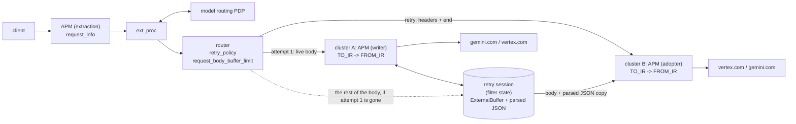

# Cross-cluster retries from an upstream retry session

Status: proposal with a prototype on this branch. Code references are at upstream/main
`d7b74bd624` plus this branch. It replaces design L, a router-written request body log, which is
in this branch's history and summarized in appendix A.

Target topology:

```
client -> ai_protocol_manager (APM) -> ext_proc (routing PDP, may rewrite the body) -> router
          -> cluster gemini  [upstream APM: TO_IR, FROM_IR, ...] (generativelanguage.googleapis.com)
          -> cluster vertex  [upstream APM: TO_IR, FROM_IR, ...] (us-central1-aiplatform.googleapis.com)
```

## Summary

- **Shape.**
  - The downstream APM only extracts: it parses the model for the routing PDP.
  - Past `request_body_buffer_limit`, the router keeps no retry copy of the body. With the limit at
    0 it keeps none at all.
  - Attempt 1's upstream APM writes the body into its external buffer and publishes it, with the
    parsed JSON, as a filter-state **retry session**.
  - Every later attempt's upstream APM takes its body from the session instead of from the router.
    It transcodes from a copy of the parsed JSON into its own cluster's API and binding.
- **One writer at a time.** The router hands the body over to the session at the point it would
  stop buffering it. The attempt it was handed over to writes it while that attempt lives. If the
  attempt fails while the body is still arriving, the router writes the rest itself. A connection
  refused mid-upload is therefore retried like a 429.
- **The retry.** The router sends a retry the headers, and once the session has the whole body, an
  empty end of stream or the trailers. The new attempt's APM claims the session at its headers.
  At the end it copies the parsed JSON, or, when attempt 1 never finished parsing, parses the
  session back from its store.
- **Fails closed.** A retry target without the session APM gets a 503, never a body-less request.
  So does a session whose store failed. Every other edge case falls back to today's behavior.
- **Cost.**
  - No router copy and no checksum.
  - One parse per request in the common case.
  - Store reads per retry are the serializer's only.
  - A body that fits the stream buffer limit costs no store IO: the session's store keeps it in
    memory (section 3.4).
- **Prototype.** 757/757 end-to-end checks with header restore on and 89/89 with it off, on a real
  `envoy-static`. A connection refused while the body is still arriving fails over at every size
  from 16 KiB to 64 MiB (section 11).

## 1. Background

### 1.1 How the APM external buffer works today

- **Ingest.** A downstream APM holds the headers. Its `BufferManager` keeps the body in memory up
  to `decoderBufferLimit()`. Once the body crosses it, the whole body, from offset 0, moves into
  one store, and replay reads only from there. Unacknowledged bytes back-pressure the client.
- **Emission.** After the AI filters run, the APM emits either `store[0, len)` (`DISABLE`) or a
  serializer walk (`ALWAYS`), through `injectDecodedDataToFilterChain`.
- **Upstream installation.** Each attempt builds a new chain from its cluster. A failed attempt's
  `UpstreamRequest` is deferred-deleted, and its filters with it, so a store an upstream APM owns
  dies with the attempt.
- **Shared state.** Upstream filters share the downstream `StreamInfo`, so filter state they set
  outlives the attempt.

What retries cost today, for a body B and a stream limit L:

| Body | Router | APM | Result |
|---|---|---|---|
| B <= L | heap B | B in the in-memory tier | 2B resident; retry works |
| B > L | gives up (`retry_or_shadow_abandoned`) | B in the store | no retry |

### 1.2 Requirements

1. **Every attempt gets exactly the bytes the router forwarded**, including when a filter between
   the downstream APM and the router changes them.
2. **Retries survive an attempt that fails before the body was sent.**
3. **One durable copy, offloaded.** Bodies larger than the stream limit stay retriable.
4. **Each attempt carries only its own cluster's settings**:

   | Cluster | Path | Credential | Host / SNI |
   |---|---|---|---|
   | gemini | `/v1beta/models/{m}:{method}` | `x-goog-api-key` | `generativelanguage.googleapis.com` |
   | vertex | `/v1/projects/{p}/locations/{l}/publishers/google/models/{m}:{method}` | `Authorization: Bearer` | `{region}-aiplatform.googleapis.com` |

5. **The PDP orders providers per request, and may rewrite the body.**
6. **Standard retry config:** `priority_group`, `refresh_cluster_on_retry`, `num_retries`.

## 2. Shape



**Which APM is "the first".** Attempt 1's upstream APM, not the downstream one. The bytes worth
keeping are the ones the router forwards, and the PDP may replace or edit the body after the
downstream APM (`CONTINUE_AND_REPLACE`, or a `BUFFERED` body mutation). Sharing the downstream
APM's store instead is safe only for a byte-verified prefix (appendix A.2).

## 3. The retry session contract

`envoy/http/retry_body_session.h` defines a `StreamInfo::FilterState::Object` under the key
`envoy.http.retry_body_session`. It is set with `LifeSpan::FilterChain` on the downstream stream,
which upstream filters share. An attempt that receives the body from its first byte replaces it.

| Member | Who | Meaning |
|---|---|---|
| `attempt()` | router | The attempt whose upstream filter last wrote or claimed the session |
| `length()` | router | Body bytes the session has taken, counted as it takes them |
| `failed()` | router | The store failed; the session will never hold the whole body |
| `handOver()` | router | The router stops keeping the body; later attempts must take it from the session |
| `attachWriter(callbacks, offset)` | router | Become the writer from `offset`, which must be `length()` |
| `Writer::append(data)`, `Writer::end()` | writer | The next body bytes; the end of the body |
| `WriterCallbacks` | writer | `onSessionAboveHighWatermark`, `onSessionBelowLowWatermark` for back-pressure; `onSessionFailed` |

**The router uses only these members.** The store, its views and the parsed snapshot stay inside
the implementation, `RetryBodySessionImpl` in the APM.

**One writer at a time.**
- The APM attaches as the writer when it creates the session.
- The router attaches once the attempt the body was handed over to is gone. Removing an attempt
  destroys its filters at once (`deferredDelete` runs `cleanUp()`), so its writer has detached by
  then; an attach that finds a writer fails, and so does the retry.
- A writer attached above the high watermark is told at once, so the watermark calls it gets stay
  balanced.

**Invariant.** Bytes `[0, length())` are exactly the bytes the router received, from offset 0. It
holds because:
- every byte the router forwards reaches the first upstream filter synchronously;
- the APM is the first upstream filter, holds headers with `StopIteration` (never `StopAll`), and
  takes each frame in the call that delivers it;
- the router appends everything after that attempt in order.

So the parsed document's external references index the session's store. The router checks the
invariant by length whenever it relies on the session.

**Lifetime.**
- The session owns the store, its queued and in-flight writes, and the snapshot.
- A write still in flight when an attempt dies completes into the session, not into a dead
  `BufferManager`.
- Each attempt reads through its own view, so destroying the attempt cancels its reads.

## 4. APM

Opt-in: `RequestHandling.retry_session: true`, on an upstream installation only, as the first
entry of the cluster's `http_filters`.

### 4.1 Writer

The attempt that receives the body from the router writes the session. That is attempt 1, or a
later attempt while the router still holds the body.

1. **`decodeHeaders`.** If there is no session, or one that was never handed over, create a session
   (replacing it), attach as its writer, and stamp the attempt.
2. **Store.** The attempt's `BufferManager` adopts a live view of the session's store, so every
   external reference has a home.
3. **`decodeData`.** Feed the parser, then append the frame to the session, which moves it. At the
   end of the body, end the session. A store that has failed ends the request at the frame that
   finds it, with this APM's 500.
4. **Snapshot.** Once parsing finishes, and only if the router has handed the body over, keep an
   immutable copy of the parsed document in the session, before any AI filter edits it. The
   transcoder rewrites it in place.

The snapshot is tagged with how it was parsed: the request API and the inline-string threshold.
It is kept only when its estimated size fits the stream buffer limit (so never at a limit of 0):
`parsed bytes - externalRefBytes + nodes x 64`. A document of many short strings is otherwise
copied for every attempt; above the cap, each adopter parses the session back instead.

### 4.2 Adopter

A later attempt takes its body from a session that was handed over.
1. **Claim at the headers.** If the session has not failed, stamp the attempt and hold the
   headers. The router may still be writing the body.
2. **Adopt at the end.** The router's empty end-of-stream frame, or its trailers, mean the session
   has the whole body. Then:
   - **with a snapshot of the same tag**, deep-copy it as this attempt's document: inline values
     are copied, large strings stay 16-byte references;
   - **otherwise**, parse the session back from its store, in 64 KiB reads, a few per event-loop
     pass. The result becomes the snapshot if the session has none; an earlier attempt's snapshot,
     parsed another way, stays for the clusters that parse that way.
3. **Output.** Transcoding renders this cluster's request. The serializer reads the large strings
   through the view, paced by this attempt's codec watermarks.

**Errors.**
- A non-empty router frame is a bug: the APM answers 500, which is never retried.
- An end that arrives before the session has ended, or a failed session or store read, gets this
  APM's 500 (`ai_protocol_manager_external_buffer_error`).
- A failed session is not claimed, so the router fails the retry (section 5.5).

The re-parse covers every way a snapshot can be missing: attempt 1 failed before parsing finished,
the snapshot was over the cap, or this cluster parses with another tag. So no parser state ever
moves between attempts.

### 4.3 Unchanged

Header handling, the transcoder legs, response transcoding and token usage.

### 4.4 Storage: a tiered ExternalBuffer

The in-memory tier lives in the store, not in the session or the buffer manager. The session's store
is `TieredExternalBuffer(configured factory, decoderBufferLimit())`:
- **Memory.** While the body fits in the stream's buffer limit, writes stay in memory and are
  acknowledged through a post, as `InMemoryExternalBuffer` does. Reads are on-stack copies.
- **Spill.** The write that would pass the limit creates the configured store and sends it one
  write: the held bytes, moved, then the new frame, at offset 0. Offsets never change, so every
  external reference in the snapshot stays valid. Reads that arrive during that write wait for it.
- **After the spill.** Everything passes straight through to the configured store.

A body that fits the limit therefore costs no store IO, as on the path without a session. The
buffer manager keeps its own tier for now; moving it onto the same decorator is a later cleanup
that touches SSE accounting.

## 5. Router

### 5.1 The knob

`request_body_buffer_limit` on the route or virtual host, an existing field:
- **`0`.** The router keeps no copy, and every body goes to the session from its first byte.
- **`N`, graded.** Bodies up to N stay on the router, so they fail over to any cluster. A larger
  body is handed over at the frame that would cross N.

Without a session, the field means what it does today: at overflow the router gives up on retries.
No runtime guard: the feature is opt-in on the cluster.

### 5.2 Hand-over

At the frame that would overflow, the router hands over instead of giving up when all of these
hold:
- there is no hedging, internal redirect, CONNECT or upgrade;
- a session exists, has not failed, was written by the last attempt, and holds every byte that
  attempt was sent.

The last attempt may still be live, or already gone with a retry waiting for its backoff. The router
then calls `handOver()`, drops its copy, and stops buffering. Shadows still get every frame.

### 5.3 Writing the rest

After the hand-over, each frame goes:
- **to the live attempt**, if it is the one the body was handed over to: its APM writes it;
- **to the session**, otherwise: the router attaches as the writer at the bytes it has received,
  and appends that frame and every later one. At the end of the body it ends the session, and
  does the same for trailers. A live attempt then gets the empty end frame or the trailers.

The router forwards the session's watermarks to the downstream as its own.

### 5.4 Retry gate

A retry needs the session not failed and holding every byte the router received. A body still
arriving is fine. Otherwise the router gives up on retries, as on today's overflow, and counts
`retry_session_incomplete`; the failing attempt's own error reaches the client. That happens when
a filter ahead of the APM held bytes back, or the APM rejected the payload. The counter also counts
a reset the retry policy would not have retried: the gate runs first.

### 5.5 Retry send

1. Send headers with `end_stream=false`. A headers-only retry would make the APM pass the request
   through, and the filter manager would drop any body injected later.
2. Check that the new attempt's APM claimed the session: `attempt()` is the new attempt. If not,
   reset the attempt and answer 503 `retry_session_not_adopted`.
3. If the body has ended, send the trailers or an empty end-of-stream frame, and arm the global
   timeout if no attempt was live when the body ended. Otherwise the router sends them when the
   body ends (section 5.3).

**Store failure.** A session that fails while the router writes it can serve no retry: 503
`retry_session_failed`, from outside the append that found it. So does a session the router cannot
attach to, and one found failed when the retry starts. Once a response is under way, a failure no
longer ends the stream; an adopter that still needs the bytes fails its own reads.

### 5.6 Unchanged and related

- **Header restore** before cross-cluster retries (section 6).
- **The upstream watermark fan-out.** `UpstreamRequestFilterManagerCallbacks` forwards the
  upstream filter manager's watermarks to that manager's own subscribers, which paces the
  adopting APM. It applies to any upstream APM, retries or not.
- **Transmit-completion reset.** Once an upstream filter injects the body, `encodeComplete()` no
  longer means the upstream stream has finished sending. Resetting by transmit completion is its
  own router PR, for every upstream filter that injects a body, after a private check.

```mermaid
stateDiagram-v2
  [*] --> Buffering: body arrives (limit N)
  Buffering --> Buffering: up to N bytes copied, as today
  Buffering --> HandedOver: frame would cross N, the session holds every byte
  Buffering --> Abandoned: frame would cross N, no usable session (today's overflow)
  HandedOver --> HandedOver: the writing attempt is live: forward, count bytes
  HandedOver --> RouterWrites: the writing attempt is gone
  RouterWrites --> RouterWrites: append, count bytes
  HandedOver --> Retrying: attempt fails, session holds every byte
  RouterWrites --> Retrying: attempt fails, session holds every byte
  HandedOver --> Abandoned: attempt fails, session short or failed (retry_session_incomplete)
  Retrying --> RouterWrites: new attempt claimed it; end sent once the body ends
  Retrying --> Failed: not claimed (503)
  RouterWrites --> Failed: store failed (503)
```



## 6. Per-attempt request adaptation

**Layer 1: router header restore.**
- When `cross_cluster_retry_` is set, the router copies the request headers before the first
  attempt's upstream filters run.
- `doRetry` restores them with `clear()` and `copyFrom`, behind
  `envoy.reloadable_features.restore_request_headers_on_cross_cluster_retry`.

**Layer 2: per-cluster chains, C++ filters only.** Each provider cluster's chain is:
1. The upstream APM, first, with `reserialize_body: ALWAYS`, `retry_session: true` and a transcoder
   pair: request `TO_IR` and response `FROM_IR`, then request `FROM_IR` and response `TO_IR`. It
   holds the headers until its legs have run, so the later filters see the path it rendered.
2. `header_mutation`, removing the other provider's credential.
3. `credential_injector` with `overwrite: true`.
4. `upstream_codec`.

**Where each cluster's instructions come from.**
- An upstream filter resolves its per-route config against the downstream stream's route, keyed by
  its own filter name. The `priority_group` route entry passes per-filter config through to its
  base route.
- So each cluster's APM gets its own name (`ai_protocol_manager.gemini`,
  `ai_protocol_manager.vertex`), and the shared route carries one `AiProtocolManagerPerRoute` per
  name: `request.llm_protocol`, and `response {llm_protocol, binding}` for that cluster's backend.
- Filter state cannot carry them: upstream filters share the downstream stream's filter state, so
  a value set once applies to every attempt.

**Conventions**, held by configuration only:
1. No `request.binding` on an upstream entry. With header restore off, an attempt reads the path
   the previous one rendered; the API's own and client bindings match both providers' paths, a
   declared one may not.
2. Every upstream entry names `response.llm_protocol` and `response.binding`. A Vertex binding
   writes project and location literally, since a Gemini API path carries neither.
3. Nothing downstream sets `envoy.ai.llm_protocol.response`, `envoy.ai.binding.response` or
   `envoy.ai.model.resolved`: any of them would pin every attempt on every cluster.
4. Every cluster the PDP can name has an entry. A missing one makes that APM pass the request
   through, and the provider answers 404.

**An APM-free cluster** works where the clients already speak its API and binding: with header
restore on, every attempt starts from the client's path. It cannot be a retry target after a
hand-over.

**Route and clusters:** `auto_host_rewrite: true`; `request_headers_to_remove: [x-pdp-decision]`;
`suppress_envoy_headers: true`; an explicit `sni` per cluster; `circuit_breakers.max_retries` sized
on every cluster.

**PDP (ext_proc).** Header-only, with `request_attributes:
["filter_state['envoy.ai.model.request']"]` for the parsed model. It answers with `envoy.ai.routing`
through `receiving_namespaces` and `route_cache_action: CLEAR`. With `allow_mode_override` it can
switch a request to a `BUFFERED` body and edit it, or answer `CONTINUE_AND_REPLACE`; every attempt
then gets the PDP's body.

**No custom retry policy is needed:**

| Need | Mechanism |
|---|---|
| Per-attempt cluster order | `priority_group` + `refresh_cluster_on_retry` |
| Per-request order | PDP metadata through `override_metadata_namespace` |
| When to retry | `retry_on: 5xx,reset,connect-failure,retriable-status-codes` + `retriable_status_codes: [429]` |
| Keep one provider's `Retry-After` from delaying the other | Leave `rate_limited_retry_back_off` unset |
| Attempt count | `num_retries` |
| Retain the body | The retry session |
| Per-provider request | Cluster upstream filters |

## 7. Flows

**F1. 429, gemini to vertex** (15 MB, limit 0):

```mermaid
sequenceDiagram
  participant R as router
  participant G as gemini APM (writer)
  participant S as retry session
  participant V as vertex APM (adopter)
  R->>G: headers (attempt 1)
  G->>S: create, attach, stamp 1
  R->>S: handOver() at the first frame (limit 0)
  loop body
    R->>G: frame (no router copy)
    G->>S: append (parse first)
  end
  G->>S: end, snapshot parsed JSON
  G->>G: TO_IR, FROM_IR (Gemini API path) and send
  G-->>R: 429
  R->>R: gate: session holds every byte
  R->>R: restore headers; attempt 2 -> vertex
  R->>V: headers (end_stream=false)
  V->>S: claim, stamp 2
  R->>V: empty end frame
  V->>S: copy parsed JSON
  V->>V: TO_IR, FROM_IR (Vertex path) from the copy; refs read from S
  V-->>R: 200
```

**F2. Three attempts or the same cluster again.** Nothing changes the session after the body
ends, so every retry passes the gate, claims the session and stamps itself.

**F3. Early connection failure** (ECONNREFUSED while the body is still arriving):

```mermaid
sequenceDiagram
  participant R as router
  participant G as gemini APM (writer)
  participant S as retry session
  participant V as vertex APM (adopter)
  R->>G: headers, first frames
  G->>S: create, append
  G-->>R: connect failure
  R->>R: gate: session holds every byte so far; retry after backoff
  loop rest of the body
    R->>S: attach at the received offset once, then append
  end
  R->>V: headers (end_stream=false)
  V->>S: claim, stamp 2
  R->>S: end
  R->>V: empty end frame
  V->>S: no snapshot: parse back, 64 KiB at a time
  V-->>R: 200
```

With limit N, a failure before N bytes arrived is retried from the router's copy, and the body may
then cross N during the backoff: the router hands the session the failed attempt wrote over to
itself, and writes the rest.

**F4. A retry target without the session APM.** The new attempt claims nothing, and the router
answers 503 `retry_session_not_adopted`. Before the hand-over, the router's own copy serves any
cluster.

## 8. Failure modes

| Event | Behavior |
|---|---|
| 429, 5xx, a reset, a connect or per-try timeout, at any point of the upload | Retried from the session, in any number of attempts |
| Body up to N | Today's router retry, to any cluster |
| PDP replaces or edits the body | Correct: the session holds what the router forwarded |
| A filter ahead of the APM holds bytes back, or the APM rejects the payload | Session short: no retry, the attempt's own answer reaches the client |
| Retry target without the session APM | 503 `retry_session_not_adopted` |
| A cluster that parses with another tag, or a snapshot over the cap | The adopter parses the session back |
| Store fails while an attempt takes the body | That APM's 500 at the next frame; an upstream filter's reply is not retried |
| Store fails while the router writes the body, or before a retry starts | 503 `retry_session_failed` |
| Store read fails in an adopted attempt | That APM's 500 (`ai_protocol_manager_external_buffer_error`), not retried |
| Hedging, internal redirect, CONNECT, upgrade | Never handed over: today's behavior |
| Request trailers | Kept by the router and sent in place of the empty end frame |

## 9. Memory and IO

For a body B, two attempts, and a store past the in-memory tier:

| | Today, B <= L | Session |
|---|---|---|
| Stored copies beyond the downstream APM's | 1, the router's heap copy | 1, the session; in memory while B fits the stream limit |
| Router copies per request | 1 | 0 past the limit |
| Upstream parses | one per attempt | one in total, or one per adopter above the snapshot cap or after an early failure |
| Store reads per retry | none (heap) | the serializer's reads of large strings |
| First byte of a retry | after the router resends B | serialization starts at the end frame |
| Extra resident | the attempt's DOM | the snapshot plus one working copy, bounded by the snapshot cap |

## 10. Prototype

**Code:**
- `envoy/http/retry_body_session.h`;
- router: hand-over, the gate, the tail writer, the retry send, the header restore, the upstream
  watermark fan-out, and stats `retry_session_handed_over`, `retry_session_incomplete`,
  `retry_session_not_adopted`, `retry_session_failed`;
- APM: `retry_body_session.{h,cc}`, `tiered_external_buffer.{h,cc}`, `filter.{h,cc}`, the proto
  field `retry_session`, and stats `request_session_written`, `request_session_adopted`,
  `request_session_reparsed`, `request_session_not_adoptable`.

**Unit tests:**
- the router: hand-over, the gate on resets and responses, a short or failed session, trailers, a
  retry that did not claim, refused hand-overs, the graded limit, a hand-over during the backoff,
  the router writing the rest of the body, a body ending during the backoff, and store failures;
- the APM: writer, snapshot and its cap, replacement, claiming, adoption, parsing back (one pass and
  several, and for another tag), an unexpected body, an early end, a failed session, back-pressure;
- the session, the tiered buffer, and a buffer manager replaying an adopted store.

**Harness** (`experiment/retry-buffer-failover/`):

| Listener | Router | Clusters |
|---|---|---|
| :19010 | `request_body_buffer_limit: 0` | `gemini`, `vertex`: APM `retry_session` + transcoder pair, `header_mutation`, `credential_injector` |
| :19012 | `request_body_buffer_limit: 1 MiB` | the same |
| :19014 | as :19010, without the PDP: nothing holds the headers ahead of the router | the same |
| :19016 | as :19012, without the PDP: the router keeps exactly the first 1 MiB | the same |
| :19002 | control: no session | `gemini_plain` (no APM), `vertex_plain` (APM, no session) |

`gemini_refused` has the session chain and points at a closed port.

## 11. Results

From `captured/`: 757/757 checks with header restore on, and 89/89 with it off.

- **Every failover** (1 KiB to 64 MiB, chunked, streaming, three steps, the same cluster again,
  an early reset, the PDP replacing or editing the body) gave each attempt the router's document,
  with its own path, credential and SNI:
  - the body was parsed once per request, however many attempts;
  - each retry adopted the session;
  - at limit 0 the router kept no copy and handed over at byte 0.
- **Graded.** On :19016 the router kept exactly the first 1 MiB and handed over at byte 1048576.
  Bodies up to 1 MiB stayed on the router, and each attempt parsed its copy. On :19012 the PDP's
  header hold hands the router most of a large body in one frame, so it hands over at byte 0 there
  too.
- **No decoding buffer.** On :19014 the router handed over at the first frame with nothing
  buffered ahead of it.
- **Refused sweep** (attempt 1 to a closed port, on loopback). Every body failed over to vertex
  whole:

  | Body | Limit 0 (:19010) | Limit 1 MiB (:19012) |
  |---|---|---|
  | 16, 64, 256 KiB | attempt 1 took it whole; vertex copied the snapshot | the router kept it |
  | 1 MiB | the router wrote from 512 KiB; vertex parsed it back | the router kept it |
  | 4, 16, 64 MiB | the router wrote from 512 KiB; vertex parsed it back | the router wrote from 1.5 MiB; vertex parsed it back |

  The refusal arrives once attempt 1 has taken one pass of the downstream APM's replay (8 x 64
  KiB), or that pass past the 1 MiB the router kept. A remote provider's refusal costs a round
  trip, so the router writes less of the body.
- **Fallbacks.**
  - A retry to `gemini_plain` after hand-over got 503 `retry_session_not_adopted`, and that cluster
    never received a whole request.
  - Attempt 1 to `gemini_plain` made no session: gemini's 429 reached the client, as at today's
    overflow.
  - A 512 KiB body on :19012 failed over to `gemini_plain` from the router's copy.
- **Counters** (`stats_restore.log`): `retry_session_incomplete` and `retry_session_failed` stayed
  at 0 on every listener.

  | Listener | `retry_session_handed_over` | `retry_session_not_adopted` |
  |---|---|---|
  | :19010 | 38 | 1 (the not-adopted case) |
  | :19012 | 12 | 0 |
  | :19014 | 6 | 0 |
  | :19016 | 5 | 0 |

  `request_session_reparsed` was 7: the sweep's bodies the router finished. The tiered store
  spilled 41 session bodies that passed the 1 MiB stream limit.
- **Timing**, indicative only: one run on a noisy machine. A 4 MiB 429 failover took 0.05 s, a 64
  MiB one 0.76 s, and a 64 MiB early reset 0.45 s.
- **Header restore off.** The walks on :19010 pass: each attempt reads the previous one's path and
  renders its own. The control's APM-free `gemini_plain` then gets vertex's path and answers 404,
  the known limit. The naive-chain leak (an earlier run, with chains that did neither) is in
  `captured/e2e_no_restore_naive_chains.log`.
- **Not exercised end to end:** a hand-over during the backoff (unit-tested), and a store that
  fails.

## 12. Decisions

| | Decision | Taken |
|---|---|---|
| S1 | Knob | Reuse `request_body_buffer_limit`, no new field and no runtime guard. Unset (the stream limit) is the graded default; 0 keeps no router copy. Both route-level docs get an overflow paragraph. |
| S2 | v2 | Built here. Lands as the PR after the contract and hand-over. |
| S3 | Targets that do not adopt | Fail closed. With the re-parse, only clusters without the session APM. |
| S4 | L | Replaced; in history and appendix A. |
| S5 | Snapshot memory | Snapshot only when its estimate fits the stream buffer limit; adopters re-parse otherwise. |
| S6 | Transmit-completion reset | Its own router PR, after a private check. |
| S7 | In-memory tier | `TieredExternalBuffer` as the session's store. |

Still open:
- **D1. Header restore scope.** Only on cross-cluster retries, or on every retry (the prototype
  restores on every retry when `refresh_cluster_on_retry` is set). Upstream chains are correct
  either way if convention 1 of section 6 holds.
- **D2. Per-cluster instructions.** Per-name route entries (the prototype, no new API), or an
  `AiProtocolManager.backend` declaration for upstream installations.
- **D3. Same-API legs.** Apply only the bindings when the APIs match (lossless, but filters between
  the legs then see the client's API rather than the IR), or keep the IR round trip and its limits.
- **D4. Upstream local replies.** Accept that an upstream APM's failure ends the request, or let
  the router treat it as retriable.
- **D5. Re-parse time.** An adopter that parses back does so after the body has ended, inside its
  per-try timeout; whether that budget should exclude it.

## 13. PR plan

Open a GitHub issue first.

1. **router:** restore request headers before every cross-cluster retry (runtime guard).
2. **router:** forward upstream-chain watermarks to upstream filters.
3. **router:** arm the global timeout when a retry starts after the body ended during the backoff.
   The prototype arms it on the session path only.
4. **router:** transmit-completion reset, after the private check.
5. **http/router:** the retry session contract, hand-over, gate, retry send, and stats. Tests use a
   fake session.
6. **ai_protocol_manager:** the tiered buffer, the session, and `retry_session`.
7. **router + ai_protocol_manager:** the router as the tail writer, claim then adopt, and the
   re-parse.

Follow-ups:
- transcoder legs that apply only the bindings when the client's and the backend's APIs are the
  same, so Gemini -> Gemini is lossless;
- an integration test for the transcoder in a cluster's upstream chain under `priority_group`
  failover, with and without header restore;
- the buffer manager's own in-memory tier on `TieredExternalBuffer`;
- `AiProtocolManager.backend {llm_protocol, binding}` for upstream installations, if reviewers
  reject per-name route entries.

## 14. Other issues found along the way

These all reproduce at upstream/main:
- **Trailers double-send.** Today's path sends the body twice when the request has trailers.
- **Latched watermark stall.** A latched watermark can keep ext_proc's parked bytes in place.
- **Full-body filter after the APM.** An APM followed by a filter that buffers the whole body
  stalls once the body exceeds the stream limit.
- **Unused size hint.** The APM never passes the content length to `createBuffer`.
- **Re-serialization without AI filters.** On a declared AI endpoint with no AI filters, `ALWAYS`
  still re-serializes, unlike what the proto says.

## Appendix A. Alternatives considered

| Option | Summary | Verdict |
|---|---|---|
| Router in-memory buffer (today) | Raise `request_body_buffer_limit` | Two copies, no offload; kept for bodies up to the limit |
| Router-owned spool | Router config names an external-buffer extension | Needs the external-buffer interface in core plus router config |
| C+. Downstream-published body | The downstream APM publishes its emitted bytes; the router replays them after a CRC check | One copy, but fails closed whenever a filter between them rewrites the body |
| L. Router-written log | The router writes every byte into a log in an APM's external buffer and replays retries from it | Worked, at about three times the router change and a copy plus a CRC per request |
| **Upstream retry session** | This document | **Taken** |

### A.1 L: a router-written request body log

A filter with an external buffer lent it as the stream's `Http::RequestBodyLog`. The router was its
only writer: it appended every byte before forwarding it, and kept appending through the backoff.
Each retry replayed from the log as it grew, holding the chunk that completes the request until a
CRC32C of the replay matched what the router received. Upstream APMs read their payload back from
the same log.

| | L | Session |
|---|---|---|
| Router change | about +480 core lines: writer, replay engine, CRC, a `RouterFilterInterface` flow-control hook (tcp_proxy and mock changes) | about +330 core lines, 220 of them in the router: hand-over in the existing overflow branch, gate, tail writer, retry send; the rest the contract header |
| Per-request CPU | a router copy and a CRC of every byte | none in the router |
| Per-retry CPU and IO | replay read, re-parse, CRC | a DOM copy and the serializer's reads; a re-parse after an early failure |
| Early connection failure | fails over: the router follows its log | fails over: the router writes the rest of the session |
| Retry target without an APM | works | 503 (fails closed) |
| End-to-end integrity check | replay CRC before the final chunk | length invariant only |

**The CRC.** L's log held the router's own bytes, so detecting a rewrite needed no checksum. The
CRC32C remained as a check against accidental store corruption on the replay, at about 0.2 ms per
4 MiB. It was no proof against a crafted body: CRC32C is linear. The session relies on the length
invariant and the store instead.

**Before the tail writer.** Without it, an attempt that failed while the body was still arriving
could not be retried, as on today's overflow. The refused sweep then showed:

| Body | L | Session, limit 0 | Session, limit 1 MiB |
|---|---|---|---|
| 16, 64, 256 KiB | retried | retried | retried |
| 1 MiB | retried | 503 | retried (router copy) |
| 4, 16 MiB | retried | 503 | 503 |

### A.2 C+ and sharing the downstream APM's store

C+ had the downstream APM publish the bytes it emitted, and the router replay them after checking
that their CRC32C matched what it received. A rewrite between the APM and the router could only fail
closed, which is the common case for a PDP that rewrites bodies.

The downstream APM's store could still serve as a prefix the router has proven it sent: a shared
length S grows only while the router's bytes compare equal to the store's, read back from it, and
stops for good at the first difference. A read returns proven bytes below S and the router's own
above it. That removes the second copy only where the downstream APM forwards byte for byte. Not
built.
